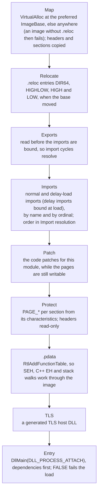
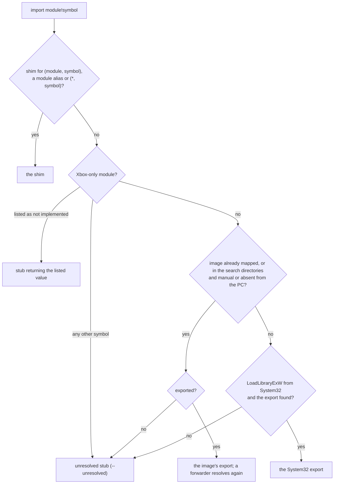
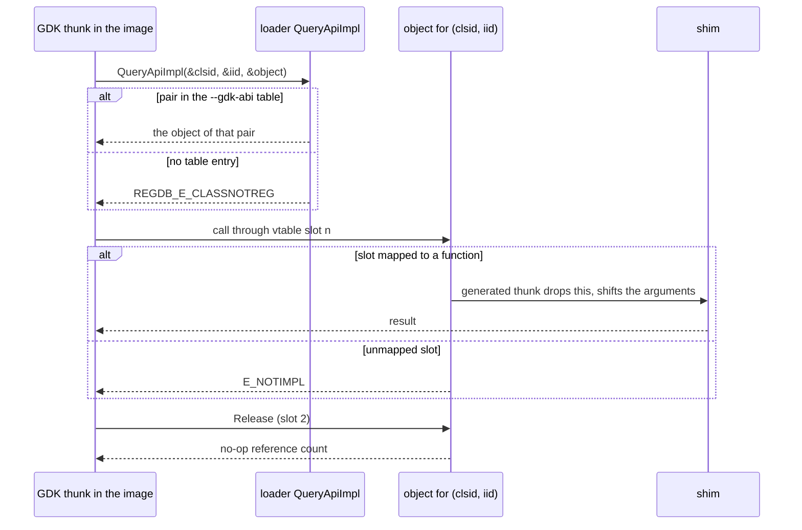

# Loader

`fivestar-loader` (`src/FiveStar.Loader`) maps the console's x64 PE images into its own process on desktop Windows
and binds their imports to C# shims, to other images it mapped, or to System32. The Xbox code is ordinary x86-64, so
nothing is translated. Until the game executable is available it is exercised on the shipped Xbox DLLs.

## Loading an image



Unloading runs `DllMain(DLL_PROCESS_DETACH)`, frees the TLS host, deletes the function table and releases the memory,
in reverse initialization order.

**TLS.** Compiled code reads implicit TLS as `gs:[58h][_tls_index]`, an array only ntdll can grow for every thread.
For each image with a TLS directory the loader writes a DLL to the work folder whose `.tls` template is a copy of the
image's relocated template and whose TLS callbacks are thunks: each copies the host's `_tls_index` into the image's
and jumps to the image callback with `rcx` = image base. After `LoadLibrary` of that DLL, ntdll has assigned the slot
and allocates blocks for existing and future threads. ntdll ignores the TLS directory of a DLL without imports, so the
host imports `kernel32!GetLastError`.

**TLS slot 0.** The linker compiles an executable's thread_local accesses as `mov rax,gs:[58h]; mov rax,[rax]`: an
executable's slot is always 0 and `_tls_index` is not read. Slot 0 of this process belongs to the host executable, so
the TLS host of a mapped executable gets two more callbacks around the image's: the first (process and thread attach)
saves the thread's slot-0 pointer in 8 bytes added after the template and points slot 0 at the executable's block; the
last (process and thread detach) puts it back before ntdll frees the blocks. ntdll runs no THREAD_ATTACH for threads
that already existed, so right after the host loads `TlsSlotZeroThreads` does the same for every other live thread
(under the loader lock; it reads each TEB through `NtQueryInformationThread`), and undoes it before the host unloads.
Without it, thread-pool workers started before the game was mapped (the program-index load starts them) ran game
completion routines against the host's slot-0 block: the game's allocator read its per-thread pointer at block+0x13A8
as 1 (fault at RVA 0x3afc after `XAsyncComplete(XUserAddAsync)`), and its writes into the 0x1480-byte TLS data
landed past the apphost's 16-byte block on the process heap ("Internal CLR error" 0x80131506, coreclr faults). `TlsHostTests` checks an early thread.

**Block size.** ntdll sizes the TLS block of a LoadLibrary'd module by its raw template alone and ignores
SizeOfZeroFill (a 16-byte-aligned block also starts 16 bytes into its heap allocation, after the allocation pointer
LdrpFreeTls frees). The host template therefore carries the image's zero fill and the saved slot-0 pointer as zero
bytes. With them as zero fill, every thread created after the game was mapped wrote the saved pointer over the next
heap entry; the corruption surfaced as a fault in LdrpFreeTls when a thread exited, and the fault reporter, entered on
that thread after its TLS array was freed, then faulted in coreclr (JIT_ReversePInvokeEnter, coreclr+0x165f05 in
.NET 10.0.7). `TlsHostTests` checks a new thread's block against its heap allocation.

**Unresolved imports.** Each gets a stub `mov rdx,[rsp]; mov rcx,id; mov rax,handler; jmp rax` in a code heap that is
never writable and executable at once; rdx carries the caller's return address, so the first-call log line names the
call site (`from game_scarlett_master.exe+0x...`). `--unresolved stub` (default) logs the first call and returns 0 or
the module's value; `trap` terminates on the call; `error` fails the load.

## Import resolution



1. **Shim.** Matched on (module, symbol), then through a module alias, then on ("*", symbol). A module declared
   Xbox-only (`xmem.dll`, `d3d12_xs.dll`, `xgameruntime.dll`, `gameinput.dll`, `acphal.dll`, `chad.dll`, `xapu.dll`,
   `xg_xs.dll`, `xcrdapi.dll`) never falls through: a function listed as not implemented binds to a stub that returns
   its listed value and logs its first call; any other symbol becomes an unresolved stub returning the module's value
   (0 for `xmem.dll`, E_NOTIMPL for the others).
2. **Image mapped by the loader.** An image already mapped, or a module found in the search directories (the
   directory of every loaded image, plus `--search`) that is either manual or not on the PC (no System32 file, no
   implemented API set). By default the manual modules are the shipped MSVC runtime: `msvcp140*`, `vcruntime140*`,
   `concrt140`, `vccorlib140`, `vcomp140`. Forwarders resolve through the same order.
3. **System32.** `LoadLibraryExW(name, LOAD_LIBRARY_SEARCH_SYSTEM32)`, so API sets resolve and a same-named DLL in
   the game folder is never picked up.

The shipped `vcruntime140.dll` is mapped by default because `_CxxThrowException` calls `RtlPcToFileHeader`, which
ntdll answers only for OS-loaded modules; mapping it lets the loader bind that import to its own shim. With
`--system-crt`, SEH still works, C++ exceptions inside a mapped image do not.

## Shims

| Shim | Behaviour |
|---|---|
| `xmem.dll` | `XMemAlloc`: requests of 64 KiB or more, or with a PageSize attribute, from `VirtualAlloc`; others from the aligned native heap, alignment from the attribute bits 24..28 (code n is 2^(n-1), at least 16). `XMemFree` releases what `XMemAlloc` returned and ignores other pointers. `XMemVirtualQuery` fills `MEMORY_BASIC_INFORMATION` and zeroes the 16-byte tail. `XMemGetWorkingSetStatistics` writes total (resident set plus free physical memory) and used (resident set) bytes. `XMemAllocDefault`/`XMemFreeDefault` as `XMemAlloc`/`XMemFree` |
| `xmem.dll` pages | Physical pages are 64 KiB pieces of pagefile-backed sections; a MEM_64K_PAGES reservation is a placeholder range and mapping replaces a 64 KiB placeholder with a view of the page, so pages alias and keep their contents across remaps ([physical-memory.md](physical-memory.md)). Other `XMemVirtualAlloc` calls go to `VirtualAlloc` with MEM_RESERVE/MEM_COMMIT and the low protection byte. `XMemIsToolsMemAvailable` and `XMemTransferMemory` return 0 |
| `d3d12_xs.dll` | `D3D12SerializeRootSignature`, `D3D12SerializeVersionedRootSignature`, `D3D12Create[Versioned]RootSignatureDeserializer` forwarded to the PC `d3d12.dll`; `D3D12XboxCreateDevice` on a desktop device and `D3D12ConfigureVirtualMemoryX` as a no-op ([d3d12x-shim.md](d3d12x-shim.md)); everything else E_NOTIMPL |
| `acphal.dll` | APU heap: `ApuCreateHeap` commits one region for both parts; `ApuAlloc` hands out zeroed, aligned blocks of it (first fit); an APU address is the offset plus 0x10000; `ApuFree`, `ApuIsVirtualAddressValid`, `ApuMapVirtualAddress`, `ApuMapApuAddress` follow. `AcpHalAllocateShapeContexts` hands out the XMA contexts from the heap and `AcpHalCreate` an IAcpHal object that accepts every message; nothing decodes XMA yet ([audio-runtime.md](audio-runtime.md)) |
| `xapu.dll` | the Opus decode queue on the CPU: commands run when enqueued (Concentus), results wait for `XApuGetResultCount` and `XApuDequeueResult` ([audio-runtime.md](audio-runtime.md)) |
| `chad.dll` | XDsp streams on the CPU: a submitted command completes at once through the status record the game polls; no effect runs, the output stays silent ([audio-runtime.md](audio-runtime.md)) |
| `xg_xs.dll` | `XGCreateTextureComputer` returns a texture address computer over the console tiling: layout, tiling, copies in and out ([xg.md](xg.md)); `XGSuggestSwizzleMode` writes 0x100 + a 4 KB or 64 KB mode |
| `xcrdapi.dll` `DStorageGetFactory` | a CPU DirectStorage factory: files through the overlay, a worker thread per queue, overlapped unbuffered reads, zlib chunks inflated into system memory, status arrays; slots the game does not call return E_NOTIMPL logged once ([directstorage.md](directstorage.md)) |
| `XboxBvhBuilder.dll` | the acceleration-structure builder class: prebuild sizes from the desktop device; builds, copies and rehydration logged once and skipped ([d3d12x-shim.md](d3d12x-shim.md)) |
| `amd_fidelityfx_loader_xbox.dll` | the five FidelityFX API functions: forwarded to the PC DLL of `--ffx` with the D3D12.X objects unwrapped, else creation reports no provider and the jitter queries are answered ([middleware.md](middleware.md)) |
| `RtlPcToFileHeader` (any module) | the mapped image containing the address, else the real ntdll function |
| `AddVectoredExceptionHandler` (any module) | registered as asked; the fault reporter of `--run` then moves back in front |
| `terminate` (any module) | logs the native stack, then calls `ucrtbase!terminate` |
| `GetModuleHandle{A,W}`, `GetModuleHandleEx{A,W}`, `GetModuleFileName{A,W}` (any module) | NULL means the main image (`--main`; else the first mapped executable, else the first `--load`); names, handles and addresses of mapped images answer with the mapping; truncation follows Windows (size-1 characters, result size, `ERROR_INSUFFICIENT_BUFFER`); everything else goes to kernel32 |
| `LoadLibrary{A,W,ExA,ExW}` (any module) | a mapped image: its base, reference counted; an Xbox-only module: a read-only page with a minimal PE header (a virtual module); a manual module or a DLL in the search directories, by name or by a path inside one: mapped now; data-file loads and the rest: the OS |
| `GetProcAddress` (any module) | mapped image: its exports; virtual module: the shim table (unknown name: NULL, error 127); OS module: the "*" shim of that name if there is one, else the real export |
| `FreeLibrary` (any module) | mapped image: reference count down; an image first mapped by `LoadLibrary` and imported by no other image is unloaded at 0; virtual module: TRUE |
| `CreateFile{W,A}`, `CreateFile2`, `GetFileAttributes{W,ExW}`, `fopen`, `_wfopen`, `_fsopen`, `_wfsopen`, `_open`, `_wopen` (any module) | the console package drive and the file overlay (below), then the real function; an ANSI call that is redirected opens the mod file through the wide function |
| `XGameRuntimeInitialize*`, `XGameRuntimeIsFeatureAvailable` | succeed; every feature available except XAppCapture, XSpeechSynthesizer and XGameStreaming |
| `XTaskQueue*` | Manual, ThreadPool, SerializedThreadPool and Immediate ports; composite queues; delayed callbacks; waiters (re-armed after each signal); monitors; terminate (pending callbacks run with `canceled = true`); duplicate and close reference counted; a process queue (ThreadPool/ThreadPool) created on first use |
| `XAsync*` | Begin, Schedule, Complete, GetStatus (with wait), GetResultSize, GetResult (identity and buffer checked), Cancel, Run; DoWork on the work port, the completion routine on the completion port, Cleanup once |
| `XUser*` | one signed-in offline user "Player" (fixed XUID); add, duplicate, close, find (by id, local id or any device), compare, gamertag, state, adult age group, every privilege granted (so `XUserResolvePrivilegeWithUi*` completes S_OK without UI); the controller picker answers the first XInput gamepad's GameInput device id; the audio endpoint is the PC's default communications device (MMDevice id); change, device-association and endpoint events register and never fire; never signing out; `XUserGetTokenAndSignature*` completes with HRESULT_FROM_WIN32(ERROR_NETWORK_UNREACHABLE) (no Xbox services token) |
| `XGameSave*`, `XGameSaveFiles*` | folders under `--save-dir`: `saves\<xuid>\<configId>\<container>\<blob>`, names %-escaped; updates staged and written per blob through a temporary file, one update, read or delete at a time, a move another process refuses (a scan holding the blob) tried again for 1 s, a failed update logged with its error (the game shows its could-not-autosave dialog for one); sync and async reads, enumeration, deletes; 256 MB quota, also for the save-files folder. A read lays out `XGameSaveBlob[n]`, the data, then the names, packed; a buffer with room for the blobs and their data only still reads (the names then point at copies the loader keeps). Each call is logged with its container, names, sizes and result |
| `XPackage*` | one installed game package at the package root with the identity from `MicrosoftGame.config`; mount returns the package root; chunks ready; installation monitors at 100 %, and a callback registered with `XPackageRegisterInstallationProgressChanged` runs once on the monitor's queue (completion port; the async block's queue for `XPackageInstallChunksAsync`), since the game reads the progress of a chunk install only inside that callback; `XPackageInstallChunks[Async]` completes at once with such a monitor; `XPackageChangeChunkInstallOrder` S_OK; `XPackageUninstallChunks` HRESULT_FROM_WIN32(ERROR_NOT_SUPPORTED), `XPackageUninstallPackage` false; no DLC, no features, nothing to download, no install writes |
| `XStoreCreateContext`, `XStoreQueryGameLicense*` | an active, full, never-expiring license for the game itself: `XStoreGameLicense` (104 bytes) with the SKU at 0x00, `isActive` 0x12, `isTrialOwnedByThisUser`/`isDiscLicense`/`isTrial` 0x13..0x15 (all false), trial id 0x1C (empty), expiration 0x60 (INT64_MAX); the game reads 0x00, 0x13..0x15, 0x1C and 0x60 |
| other `XStore*` the game calls | an unreachable store; no license or entitlement is ever reported. `XStoreAcquireLicenseFor{Package,Durables}*`, consumable balance and fulfillment, user collections/purchase ids and package downloads complete with E_GAMESTORE_NETWORK_ERROR (0x89245301) and no handle; `XStoreIsLicenseValid` false; entitled/associated product queries return an empty one-page query handle; the update query finds no updates; purchase, product page and redeem UI end with E_ABORT; `XStoreQueryPackageIdentifier` maps only the game's store id; license-changed and license-lost events register and never fire |
| `XSystem*`, `XThread*`, `XGameGetXboxTitleId`, `XGameEventWrite`, `XError*`, `XPersistentLocalStorage*` | device type 7 (Series X) unless `--device-type`; fixed console and sandbox ids; app-specific device id: Base64 SHA-256 of title id and PC name; any non-null handle valid; time sensitivity per thread; title id from the config; events dropped; local storage in `--save-dir\localstorage`, a space prompt succeeds when the space is free, else E_ABORT |
| `XGameUi*` | no system UI: dialogs complete through XAsync as if closed at once; S_OK for achievements, profile card, invites, error and state share; the message dialog answers its cancel button; the player picker picks nobody; text entry and web sign-in end with E_ABORT |
| `XNetworking*` | connectivity hint: network initialized, cost unrestricted, level None (`--network offline`) or InternetAccess (`--network sealed-online`; `--network-level` overrides); sealed online each connectivity-change callback runs once on its queue right after it registers, offline never; preferred UDP port 3074 (sync and async); the port-change event registers and never fires; `XNetworkingQuerySecurityInformationForUrl*` completes and `XNetworkingVerifyServerCertificate` fails (closed) with HRESULT_FROM_WIN32(ERROR_NETWORK_UNREACHABLE): the request handle belongs to the game's HTTP stack and no request is live offline |
| `XDisplay*` | HDR: Enabled with the display's luminance when the primary display's desktop runs HDR10 (DXGI `GetDesc1`), else Disabled; a timeout deferral holds a "display required" power request |
| `XClosedCaption*`, `XHighContrastGetMode`, `XSpeechSynthesizer*` | captions white on black at scale 1, enabled as the game last set; high contrast from the Windows setting; no voices; `XSpeechSynthesizerCreate` HRESULT_FROM_WIN32(ERROR_NOT_SUPPORTED), so no synthesizer or stream handle exists and the calls taking one return E_INVALIDARG |
| `XLaunchUri`, `XLaunchRestartOnCrash`, `XLaunchNewGame`, `XGameInvite*`, `XGameActivation*`, `XGameProtocol*` | an http(s) URI opens in the browser, others are logged; restart arguments recorded; a new-game launch is logged and the game keeps running; invite, activation and protocol events register and never fire |
| `XAppCaptureTakeScreenshot` | HRESULT_FROM_WIN32(ERROR_NOT_SUPPORTED) |
| `gameinput.dll` `GameInputCreate` (also ordinal 1, how the executable imports it) | an IGameInput over XInput, the keyboard, the mouse and a keyboard-and-mouse virtual gamepad (below); also registered as `xgameruntime.dll!GameInputCreate` for the thunk ABI table |
| other `xgameruntime.dll` functions of the public headers | not implemented: E_NOTIMPL, E_GAMESTREAMING_NOT_INITIALIZED for game streaming, or 0 for bool, count and void functions; first call logged |

Of the 365 named thunks in `libHttpClient.GDK.dll`, 154 have a shim and 211 a not-implemented entry, so each one returns
a deliberate value (before this table grew: 88 shims, 186 entries, 91 left to the module default). Of the 416 thunks of
the PC GDK 261000 library, 247 have a shim; the game calls 161 of them, all shimmed. The library has no XAchievements, XUserStats, XThread affinity, XMemory or clock
functions; achievements and stats are Xbox services that titles reach over HTTP.

The GDK shims also answer for any `api-ms-win-*gaming*` or `ext-ms-win-*gaming*` module name, for symbols starting
with `X`; other functions of those API sets go to System32.

A shim that reports a last error is entered through a generated wrapper that writes `TEB.LastErrorValue` after the
managed method returns, because the runtime's return path resets the value a managed `SetLastError` set. The wrapper
copies up to 8 stack arguments (the fifth and later) into its own call.

## Network seal

No connection leaves the process, whatever `--network` says. The executable imports WinHTTP and Winsock (most of
ws2_32 by ordinal), `libHttpClient.GDK.dll` and `XCurl.dll` import WinHTTP; these entry points are shims for every
importer, by name and by ordinal, and `GetProcAddress` on the system DLL hands out the same shims.

| Entry point | Sealed answer |
|---|---|
| `WinHttpConnect` | NULL, ERROR_WINHTTP_NAME_NOT_RESOLVED: no connection handle ever exists |
| `WinHttpOpenRequest`, `WinHttpSendRequest`, `WinHttpReceiveResponse`, `WinHttpReadData`, `WinHttpWriteData`, `WinHttpQueryDataAvailable` | NULL or FALSE, ERROR_WINHTTP_CANNOT_CONNECT |
| `getaddrinfo`, `GetAddrInfoW`, `GetAddrInfoExW`, `GetAddrInfoExA`, `gethostbyname`, `gethostbyaddr` | WSAHOST_NOT_FOUND; `getaddrinfo` and `GetAddrInfoW` of this computer's own name, `""` and `localhost` go to Windows, which answers them from the local interfaces |
| `connect`, `WSAConnect`, `WSAConnectByName{W,A}`, `WSAConnectByList`, `sendto`, `WSASendTo` | SOCKET_ERROR or FALSE, WSAENETUNREACH (WSAHOST_NOT_FOUND for the by-name connects) |
| `listen` | WSAENETDOWN |
| `WSAIoctl` | WSAEOPNOTSUPP, so ConnectEx and WSASendMsg cannot be fetched |
| `HCInitialize` (libHttpClient) | installs a perform function with `HCSetHttpCallPerformFunction`, then runs the library's own; every `HCHttpCallPerformAsync` completes with network error HRESULT_FROM_WIN32(ERROR_WINHTTP_NAME_NOT_RESOLVED) |

Sockets are still created and bound, so a bound UDP port can appear (the game binds 0.0.0.0:3074 once its host-name
lookup succeeds), but nothing can be sent from it. Each blocked target is logged once as
`[network] blocked <function> <host:port | URL>`, each local lookup as `[network] allowed ...`. Session, option,
header and URL-cracking WinHTTP functions stay with the system DLL; they send nothing.

**How the executable reads the hint.** Three call sites; each checks the HRESULT and reads one field.

| Reader | Field | Used for |
|---|---|---|
| "has internet" (RVA `0xf9d80`; false without a call while a global byte flag is set) | level 3 or 4 | an online-state monitor (RVA `0x266ea0`, which flips its online flag on a change), a ten-state machine (RVA `0x3dd4e10`, which without internet records failure reason 12), two more callers |
| "network initialized" (RVA `0x18e7260`, behind `XGameRuntimeIsFeatureAvailable(XNetworking)`) | `networkInitialized` | three callers |
| start-up wait (RVA `0x1cf8f00`) | `networkInitialized` | when false: registers a change callback with an event as context and waits on it, then unregisters |

Levels Unknown, None and LocalAccess therefore take the same branches; only InternetAccess and
ConstrainedInternetAccess differ.

## Code patches

`--patches <file or folder>` (repeatable) reads patch files; a folder contributes its `*.fspatch` files in name
order. A `[name]` line starts a patch, `key = value` lines describe it, `#` starts a comment.

| Key | Meaning |
|---|---|
| `module` | image file name (required) |
| `sha256` | SHA-256 of the image file; another build skips the patch |
| `enabled` | `true` (default) or `false` |
| `description` | free text |
| `pattern` | hex bytes separated by spaces, `??` for any byte (required) |
| `matches` | how many matches the pattern must have, default 1; each one is patched |
| `offset` | from the start of a match to the first written byte; decimal, `0x` hex, may be negative; default 0 |
| `bytes` | the replacement bytes |
| `jump` | `module!symbol` of a shim; writes `mov rax,<shim>; jmp rax` (12 bytes) |

Exactly one of `bytes` and `jump` is given. A jump target is looked up like an import (module, alias, then `*`), so
`jump` sends a game function to any shim, for example one written for raw mouse input.

```
# Bink2Scarlett.dll: BinkUtilCPUs is mov eax,7; ret
[twelve-cpus]
module = Bink2Scarlett.dll
description = report 12 CPUs
pattern = B8 07 00 00 00 C3 CC ?? ?? ?? ?? ?? ?? ?? ?? ?? F7 DA
offset = 1
bytes = 0C
```

Patches run in the order given, after relocation and import binding and before section protection, TLS and
`DllMain`. The pattern is searched over the whole mapped image. Each patch is logged as `applied` (with the written
offsets), `skipped` (disabled, or a different SHA-256) or `failed` (not found, a different match count, a write
outside the image, an unknown shim). A skipped or failed patch writes nothing.

## File overlay

`--mods <dir>` (repeatable) adds a mod folder; the first given has priority. When mapped code opens a path inside the
package root (`--package-root`, else the main image's directory) through one of the file shims, the loader takes the
path relative to the root and opens the same relative path in the first mod folder that contains that file. Paths
outside the root, and files no mod folder has, open unchanged. `\\?\` prefixes and relative paths are resolved first.
Each redirect is a detail line in the log (`[overlay] CreateFileW("...") -> "..."`), and with a log file every path
the file shims see is one (`[file] GetFileAttributesW("...")`).

The console mounts the game package as drive `G:`; a path starting with `G:\` is mapped to the package root before the mod
folders are consulted.

Directory listings (`FindFirstFile*`) are not merged: a file only a mod folder has opens, but is not listed.

## The GDK thunk ABI

GDK titles link `xgameruntime.lib`, which loads `xgameruntime.dll`, looks up `InitializeApiImpl`,
`InitializeApiImplEx`, `InitializeApiImplEx2`, `QueryApiImpl`, `UninitializeApiImpl` and `XErrorReport`, and implements
every `X*` call as `QueryApiImpl(&clsid, &iid, &object)` followed by a COM-style call through the object's vtable.
`libHttpClient.GDK.dll` contains this library.



The loader answers `LoadLibraryExW("xgameruntime.dll")` with a virtual module, makes the `InitializeApiImpl*`
functions succeed and logs `XErrorReport`. `QueryApiImpl` builds one object per (clsid, iid) from a table of
`(clsid, iid, slot) -> function name`: slots 0..2 are IUnknown (no-op reference counting), and each mapped slot is a
generated thunk that drops `this` and shifts the arguments one position (integer registers, the stack, `xmm1..3`) into
the named shim. Unmapped slots return E_NOTIMPL. A pair without a table entry returns `REGDB_E_CLASSNOTREG`, and each
requested pair is logged once.

The table is loaded with `--gdk-abi <file>`, one entry per line, `#` starting a comment:

```
# clsid                                  iid                                    slot  function
11111111-2222-3333-4444-555555555555   66666666-7777-8888-9999-aaaaaaaaaaaa   3     XTaskQueueCreate
```

The repository ships no table; `fivestar platform gdk-abi` builds one from the public PC GDK (see
[platform.md](platform.md)). Without `--gdk-abi` the loader reads the newest 64-bit `xgameruntime.lib` under
`Program Files (x86)\Microsoft GDK` the same way; with no GDK it warns and the table stays empty. With an empty table
every thunk fails: `HCInitialize` of `libHttpClient.GDK.dll` returns `0x89240107`, and the executable, whose
`XSystemGetXboxLiveSandboxId` buffer then stays empty, matches none of `RETAIL`, `CERT`, `RKTR.99`, `CERT.DEBUG` or
the `RKTR` prefix and hits an `int3` (RVA `0x3dda76b`).

## GameInput

`gameinput.dll` is declared Xbox-only, so the PC GameInput.dll is never loaded; API-set names matching
`*-ms-win-*gameinput*` answer for symbols starting with `GameInput`. The layouts follow GameInput.h of the PC GDK
251005 (API v0) and live in one file, `Shims/Input/GameInputLayout.cs`.

| Interface | Implemented | Behaviour |
|---|---|---|
| IGameInput | QueryInterface, AddRef, Release, GetCurrentTimestamp, GetCurrentReading, GetNextReading, GetPreviousReading, RegisterDeviceCallback, StopCallback, UnregisterCallback, FindDeviceFromId | timestamps in microseconds; readings filtered by kind (any bit in common, 0 matches all) and device; no match: `GAMEINPUT_E_READING_NOT_FOUND`; FindDeviceFromId finds connected devices only, else `GAMEINPUT_E_DEVICE_NOT_FOUND` |
| IGameInputReading | QueryInterface, AddRef, Release, GetInputKind, GetSequenceNumber, GetTimestamp, GetDevice, GetRawReport (false), GetKeyCount, GetKeyState, GetMouseState, GetGamepadState | the state is copied out of the reading object |
| IGameInputDevice | QueryInterface, AddRef, Release, GetDeviceInfo, GetDeviceStatus, GetBatteryState (unknown), SetRumbleState (low and high motors) | |

Every other slot logs its first call and returns E_NOTIMPL, or 0 for a method that does not return an HRESULT.

The executable uses the v0 layout: `GameInputCreate(IGameInput**)` through one cached getter, IGameInput slots 4
(GetCurrentReading), 5 (GetNextReading), 6 (GetPreviousReading), 9 (RegisterDeviceCallback with blocking enumeration),
13 (UnregisterCallback with a timeout) and 16 (FindDeviceFromId); reading slots 14, 15 (keys) and 22 (gamepad);
device slot 3, from whose info it copies the id at +0x20. It asks only for the Gamepad (0x40000) and Keyboard (0x10)
kinds, never Mouse, so the mouse reaches it through the keyboard-and-mouse gamepad.

**Gamepad to user.** The game pairs pads and users itself; it calls no XUser device-association API. Its user manager
(0x149ab3020) registers the Gamepad callback (0x142211cc0) and keeps four user slots (+0x28, 0xA0 each) with their
committed copies (+0x2A8). A gamepad that connects while a slot has a user and no pad goes to that slot; otherwise it
waits in an unassigned list (+0x560). The manager's per-frame update (vtable +0x18, from the platform task
0x1405389e0) polls the unassigned pads (GetCurrentReading, then GetPreviousReading) and pairs the first one whose
buttons change to none (a press and release), then copies changed slots to the committed set and notifies listeners.
The profile listener then binds the pad (0x143db1140) and the per-pad update (0x140e79510) posts the sign-in message
(type 2) that fills the active-player record (0x1498489c8). With no user yet at boot, the callback parks the pad, so
pairing needs that per-frame update and a press.

QueryInterface answers IUnknown and the object's own interface id; any other id gets E_NOINTERFACE, logged once.

| Device | Source | Kind |
|---|---|---|
| XInput gamepad 1..4 | `xinput1_4.dll`; sticks -1..1, triggers 0..1, no dead zone; an empty slot is probed once a second | Gamepad, family XboxOne |
| Keyboard | `GetAsyncKeyState`; up to 16 keys per reading, scan code from `MapVirtualKeyW`, code point 0 | Keyboard |
| Mouse | `GetCursorPos` deltas accumulated into the position; buttons from `GetAsyncKeyState`; no wheel | Mouse |
| Keyboard and mouse gamepad | the mapping below | Gamepad, family Virtual |

The sources are polled on the game's own calls, at most once per millisecond and by one thread at a time; a reading
is added only when a device's state changes. The last 256 readings are kept; a reading the game holds is never
reused. The keyboard and mouse sources need no window and read the whole desktop whether or not the game has focus;
mouse motion stops at the screen edges. `RegisterDeviceCallback` reports connected devices on the calling thread
before it returns (for asynchronous and blocking enumeration alike); later connects and disconnects are reported on
the thread whose call polled them. Releasing IGameInput or a device to 0 keeps the object for the process.

**Keyboard-and-mouse gamepad.** `--input <file>` replaces settings of the default mapping, one per line, `#` starting
a comment:

```
virtual-gamepad    on                # on | off at start
toggle             ScrollLock        # key that connects and disconnects it; none for no key
left-stick         W A S D           # up left down right; diagonals on the unit circle
mouse-sensitivity  1.0               # right-stick deflection per 1000 px/s of mouse motion
mouse-curve        1.0               # exponent after clamping to the unit circle
left-trigger       MouseRight
right-trigger      MouseLeft
b C
x R
y F
left-shoulder Q
right-shoulder E
left-thumb LeftShift
right-thumb V
```

These are the defaults. `a`, `menu`, `view` and `dpad-up`, `dpad-down`, `dpad-left`, `dpad-right` have no key until a
line gives them one (`a Space`, `dpad-down Down`); the first-run screens want A and the d-pad
([running.md](running.md#first-run-in-the-game)). Keys are letters, digits, `F1`..`F24`, `Space`, `Tab`, `Enter`, `Escape`, `Backspace`,
`CapsLock`, `ScrollLock`, `Insert`, `Delete`, `Home`, `End`, `PageUp`, `PageDown`, the arrows `Up` `Down` `Left`
`Right`, `LeftShift` `RightShift` `LeftCtrl` `RightCtrl` `LeftAlt` `RightAlt`, `MouseLeft` `MouseRight` `MouseMiddle`
`Mouse4` `Mouse5`, a virtual-key code as `0x..`, or `none`. The right stick follows mouse speed: deflection =
sensitivity × speed / 1000 px/s, clamped to 1, then raised to the curve exponent; screen down is stick down.

## Running it

To boot the game from a dump, use `fivestar run <dump>` ([running.md](running.md)): it builds the shaders and
picks these options. The loader runs on the JIT; a NativeAOT build compiles but cannot run the game
([aot.md](aot.md)). The loader on its own:

```powershell
dotnet build FiveStar.slnx
$dump = "<your dump folder>"
fivestar-loader --load $dump\XboxBvhBuilder.dll --load $dump\Bink2Scarlett.dll --call all --unload --log run.log
```

A log opens with the run's identity (`RunIdentity`): the loader's build, whose version carries the commit it was built
from, the .NET version and the whole command line, so a log says which build and which options (skipped pipelines,
guards, the shader backend chosen) shaped what it shows. The shader backend and its validator are named again when
the first program is made (`[d3d12_xs] programs made on demand with ...`).

| Option | Meaning |
|---|---|
| `--load <dll>` | map an image (repeatable) |
| `--run`, `--run-timeout <s>` | run the main executable's entry point (below) |
| `--call <export>` / `--call all` | call an export that was disassembled first (`--list-safe-calls` lists them); others are refused |
| `--main <name>` | the image that plays the process executable |
| `--patch-peb` | also point `PEB.ImageBaseAddress` at the main image (restored at exit) |
| `--save-dir <dir>` | root of saves and local storage; default `%LOCALAPPDATA%\FiveStar\GdkData\<TitleId>` |
| `--gdk-abi <file>` | the thunk ABI table; default: from an installed PC GDK |
| `--package-root <dir>` | where `MicrosoftGame.config` is read; default the main image's directory |
| `--device-type <n>` | `XSystemGetDeviceType` result. The title does not pick its Series X or Series S profile from it: code linked into it (+0x55deb88) reads `ConsoleMode` under `HKLM\Software\Microsoft\Windows NT\CurrentVersion\OEM` (0x60 Series S, 0x64 Series X), and the one test of the result (+0x75140) asks only whether it is Series S. We do not answer that read, so on a PC the value is missing and the title runs its Series X profile (its 64 MiB back-buffer pool, +0x75420) |
| `--network offline\|sealed-online` | the connectivity level reported: None (default) or InternetAccess; outbound traffic is sealed either way ([Network seal](#network-seal)) |
| `--network-level <l>` | report this level instead: 0..4 or `Unknown`, `None`, `LocalAccess`, `InternetAccess`, `ConstrainedInternetAccess` |
| `--patches <file or folder>` | code patches (repeatable) |
| `--mods <dir>` | mod folder over the package root (repeatable, first has priority) |
| `--input <file>` | the keyboard-and-mouse gamepad mapping |
| `--shader-dir <dir>`, `--translated-dir <dir>` | extracted FSSM programs (the D3D12.X pipeline slots then create pipelines) and, optionally, their translated DXIL |
| `--program-cache <dir>`, `--no-on-demand`, `--dxc <path>`, `--shader-jobs <n>`, `--shader-backend dxil\|dxc`, `--max-driver-compiles <n>`, `--compile-ceiling <GB>` | programs translated and compiled on first use ([d3d12x-pipelines.md](d3d12x-pipelines.md#programs-on-demand)): their folder, off, the `dxcompiler.dll`, the threads, the compiler (default the DXIL backend, dxc as its fallback) |
| `--shader-overrides <dir>` | hand-written `<program>.hlsl` or `.dxil` run in place of those programs' translations, under their own cache names; `fivestar shader override-init` starts one ([shader-translation.md](shader-translation.md#replacing-a-translation)) |
| `--ffx <dll>` | the PC FidelityFX API DLL the game's FidelityFX calls go to ([middleware.md](middleware.md)) |
| `--d3d12-debug`, `--d3d12-gpu-validation` | the D3D12 debug layer (and GPU-based validation) and DRED, with their messages and the removal report in the log ([d3d12x-shim.md](d3d12x-shim.md)); needs the Graphics Tools optional feature |
| `--d3d12-dred` | DRED alone (auto-breadcrumbs, page faults and the removal report), without the debug layer, which slows every call |
| `--aftermath [dir]`, `--aftermath-dll <path>`, `--aftermath-markers`, `--aftermath-resources`, `--aftermath-shader-info`, `--aftermath-selftest` | NVIDIA Nsight Aftermath GPU crash dumps (`.nv-gpudmp`, `.nvdbg`) into `<dir>` (default `aftermath`) and a summary in the log; needs the user's `GFSDK_Aftermath_Lib.x64.dll` (next to the loader, `--aftermath-dll`, or `%NSIGHT_AFTERMATH_SDK%\lib\x64`; one warning when missing); the device features are off by default (flags 0): markers name each operation's pipeline and cost per draw, resource tracking and shader debug info cost GBs ([debugging.md](debugging.md#aftermath)) |
| `--pix-capture <n,...>`, `--pix-capture-dir <dir>` | PIX GPU captures: the newest `WinPixGpuCapturer.dll` under `%ProgramFiles%\Microsoft PIX` is loaded before the device (one warning when PIX is missing: `winget install Microsoft.PIX`); capture N runs from present N-1 to present N (`PIXBeginCapture2`/`PIXEndCapture`), the frame `present-N.png` shows, into `<dir>\present-N.wpix` (default `pix-captures`) |
| `--d3d12-skip <i:n,...>` | D3D12.X slots that do nothing and return 0 (`list:20`, `queue:35`, `device:127`), to bisect GPU faults ([d3d12x-shim.md](d3d12x-shim.md#debug-layer)) |
| `--d3d12-breadcrumbs` | a GPU marker before every draw and dispatch, so a stalled queue names the operation and pipeline it stopped at ([d3d12x-shim.md](d3d12x-shim.md#queue-progress)). Every operation of a recording is kept (chunks of 512, up to 65,536): a stop names its kind, counts (an ExecuteIndirect's max count, argument buffer offset and arguments), pipeline and the window offsets of its root tables; the loader's own pipelines are named `loader:<what>` (indirect clamp, UAV fill, rectangle-list variant, depth-twin copy) and an unnamed one says so |
| `--gpu-timings` | GPU time per pass (#40): a pass is a run of work in one command list between render-target changes, a switch between draws and dispatches a change of compute pipeline (so each compute program is timed alone), a split at a memory wait (the queue's wait between the list's segments is its own pass, `(memory wait)`, not the previous one's), or our argument clamp before an ExecuteIndirect (its own pass, `loader:indirect-clamp`, before the execution's), named by its first pipeline's first program (container prefix and hash dropped); each pass begins with a timestamp query, Close ends the last and resolves the list's block of 256 into a readback buffer, and a thread reads each submission 50 ms after its queue fence passed (no GPU wait). The sample line ends with "gpu over N frames: queue #n busy X ms/frame (pass A ms, ...)", the 10 largest per queue per frame, then "all queues: some queue busy U of the S ms/frame their work spanned, none I" (each recording's span placed on the CPU clock by its queue's clock calibration, taken again every second: how long no queue had work while the frame's work was in flight), and the recordings without a free block, read after their block was reused, or with more than 63 passes (later boundaries extend the last pass, named with `+rest`). One query per pass, not per draw (`GpuTimings`) Then "work per frame" for the passes shown: dispatches and their groups (largest X x Y x Z), and indirect executions with their most records and, from the first two clamped executions per pipeline per frame, the first clamped record copied to a readback slot and read at the next report (`WorkShapes`) |
| `--frame-log <n>` | the CPU side of every n-th frame and of every frame of 250 ms or more (#39): `[frame] present N: X ms = game G (our submit path S, of it texture refresh R, waits for lists' previous runs W, depth-twin preludes D; descriptor mirroring M; GC pauses C in a/b/c collections of gen 0/1/2, A MB allocated) + present P (latency wait, retire wait, copy submit, Present)`. Submit and mirroring are summed over every thread that ran them. W is the CPU blocked at a submission until the GPU finished that list's previous run (a list the game submits again while it still runs): the GPU's backlog, not our work. After VIctory's frame log (facts only), which placed that fork's render thread in its submit path for 257 of 292 ms a frame (`FrameLog`) |
| `--gc-sustained` | the GC in SustainedLowLatency mode: background full collections only, no blocking ones (ConserveMemory's compactions included) unless memory runs low. Off by default: on a machine whose commit is the limit the heap may grow; compare with `--frame-log`'s GC pauses and collections |
| `--mesh-launch` | mesh draws launched by an amplification stage of ours (`MeshLaunch`, after Kelvaroq's patch 0041): an ExecuteIndirect of one mesh record without a count buffer becomes a DispatchMesh(1, 1, 1) whose stage reads the record where the game wrote it, bounds it as the clamp does (65,535 groups, one dimension), charges the list's work budget and launches the mesh groups, with no clamp pass or barrier of ours between draws; other mesh calls are clamped and launched record by record. Mesh programs made on demand declare a 4-byte payload (`TranslationOptions.MeshPayload`, part of the program cache's identity, so they are made again), and a pipeline gets the stage only when its mesh programs declare it. The stage is compiled with dxc at start; without it mesh draws are clamped as before. Off by default |
| `--clamp-enhanced-barriers` | the indirect-argument clamp's scratch takes enhanced buffer barriers (`ClampBarriers`), where the device has them (D3D12_OPTIONS12): one before a recording's first clamp in the buffer and one per clamp from its writes to the argument fetch, instead of three legacy transitions per ExecuteIndirect, the first of which waits for the previous indirect execution (w95a: 10-15 ms a frame in `loader:indirect-clamp`). Not with `--mesh-launch`. The clamp's first use logs which form runs. Off by default |
| `--typeless-depth` | opt-in: depth textures in a typed desktop depth format (D32_FLOAT, D24_UNORM_S8_UINT, D16_UNORM, D32_FLOAT_S8X24_UINT) are made in its typeless family (R32, R24G8, R16, R32G8X24), as the console depth formats already are, so a shader view the game places at their address reads the depth plane instead of a null view; depth-stencil and shader views without a desc get the typed format and the depth-plane SRV format. VIctory and its fork make the depth textures shaders read typeless (facts only). The console-address counters split null views by cause (`ViewNullBufferUncovered`, `ViewNullBufferRange`, `ViewNullInsideWritten`, `ViewNullDepth`, `ViewNullNoTexture`) and count `ViewDepthResolved` |
| `--no-gpu-timeout` | every command queue the game makes gets D3D12_COMMAND_QUEUE_FLAG_DISABLE_GPU_TIMEOUT (the game asks for it itself on some compute queues): work past Windows' 2 s limit stalls the queue instead of removing the device, and the queue progress report names it |
| `--driver-background-work` | leaves the driver's background shader work on. By default the loader turns it off (ID3D12Device6::SetBackgroundProcessingMode, DISABLE_BACKGROUND_WORK, `BackgroundProcessing`): NVIDIA's driver recompiles the shaders in use in the background and keeps the results ("optional shaders") in the same tables as the first compiles, which cannot pass 512 MiB; when they cannot grow the driver removes the device inside ExecuteCommandLists (E_INVALIDARG there, DXGI_ERROR_DEVICE_REMOVED with no GPU fault and no Windows event: boots w186 to w222, at present 2500 to 3250). In w222 the optional shaders were 169 of the 524 MiB wanted at the loss and all the growth of its last two minutes; with the work off they stay at 0 (w243). Windows refuses the mode without developer mode (0x887a002d, DXGI_ERROR_SDK_COMPONENT_MISSING: issue #64's machine, where the optional shaders then reached 285 MiB): the loader warns with the code and what follows, and discards the driver's measurements every 2 s instead (the same call with the mode ALLOWED and D3D12_MEASUREMENTS_ACTION_DISCARD_PREVIOUS; `--discard-driver-measurements` does only that, to measure it: in w340 the optional shaders still grew, to 42 MiB at 1,330 pipelines in use where w240 had 57 at 1,291, so it slows them at best). See [running.md](running.md#developer-mode) |
| `--no-shader-table-guard` | turns `ShaderTableGuard` off. It works on NVIDIA adapters only (PCI vendor 0x10DE; elsewhere it does and logs nothing), and on an estimate alone it only warns: pipelines are held or given up when the table was read from the driver or the background work was refused; the log line names the source. Every 64 presents it takes the size of the driver's larger shader table, read from the driver where its layout is known (NVIDIA 32.0.16.2124) and else estimated as 1.5 times the DXIL of the pipelines lists have set (w244: 352 MiB of table for 245 MiB of DXIL; the driver's background recompiles are not in the estimate). At 400 MiB it warns once; from 470 MiB on, pipelines no list has set yet stay stand-ins and their draws are skipped (never clears, blits, UI or lighting pipelines), until it is below 440 MiB again: missing draws instead of a removed device. From 495 MiB on (the recompiles of the pipelines in use go on where they could not be turned off) pipelines unused for a while are given up too, as with `--pipeline-shader-budget` at three quarters of the DXIL in use. Without the driver's layout and with the background work on, the estimate is doubled (issue #64: 285 of 537 MiB were recompiles) |
| `--pipeline-shader-budget <MiB>` | (default 0 = never; a measure of its own, of little use so far: in w241 and w242 nine tenths of the pipelines in use were set again within 150 presents) the DXIL the built pipelines may hold before unused ones are given up (`PipelineEviction`): NVIDIA's driver keeps the code of every shader a submitted list used while a pipeline with it lives, in tables of at most 512 MiB, and removes the device when they cannot grow (E_INVALIDARG inside ExecuteCommandLists, DXGI_ERROR_DEVICE_REMOVED with no GPU fault: boots w186 to w222, at about 2,200 shaders). Every 64 presents over the budget, pipelines no list has set for 600 presents (down to 150 while still over) become stand-ins again and are built again at their next use, their draws skipped meanwhile; clears, blits, UI and lighting pipelines are kept. `--d3dkmt-watch` logs the driver's tables beside the budget |
| `--d3dkmt-watch` | who removes the device: the graphics kernel calls of D3D12Core and the display driver (win32u's NtGdiDdDDI* stubs, the D3DKMT thunks) are watched, and each failing call (NTSTATUS, stack; the first 4 per call and status, then counted), every D3DKMTMarkDeviceAsError (user mode giving the device up) and every device state other than active are logged; at a removal the kernel's execution, reset and page fault state of each device follow (`[d3dkmt]`). A successful call costs a jump |
| `--output WxH` | the title renders and presents at one of its own modes (1280x720, 1664x936, 1920x1080, 2560x1440, 3840x2160) instead of the 3840x2160 its settings hold: a jump at +0x224352b goes to a stub of ours that writes the size into the live settings (+0x204, +0x208) and continues in the title's own else-path, so the device parameters and the render size (2/3 of it) follow; below 4K the back-buffer pool's all-but-2-MiB check (+0x247af25, an `int3`) is jumped over. Build 1.0.2.1 only (SHA-256 and every byte checked; a 5-byte `jmp rel32` patch kind with its stub just below the image, `NearStubs`). After VIctory-7900XTX's `VICTORY_OUTPUT` (facts only), which measured about 16 ms less GPU time a frame at 1080p |
| `--gpu-keep-awake` | a compute queue of ours runs one group of 64 threads counting in a loop (about 2 ms a dispatch at full clocks, at most two in flight) while the game submitted within 250 ms, so the GPU's clocks stay up through the gaps between the game's submissions; `--gpu-keep-awake-turns` runs it 20 s on and 20 s off, the log naming each turn, for an A/B in one boot. After VIctory-7900XTX (`VICTORY_CARD_AWAKE`, GPL-3.0, ported), whose replay of a 28.6 ms frame took 37.8 ms with the title's gaps and 28.6 ms with it (AMD RDNA3). **Warning:** on an RTX 5090 the loop's dispatch beside the game's work lost the device at 100 to 154 s in every boot (DXGI_ERROR_DEVICE_HUNG, the ped skinning programs resident and not advancing); without it the same boots ran 660 s (issue #64). Leave it off unless you measure with it |
| `--indirect-gather` | opt-in: an ExecuteIndirect without a count buffer (up to 64 records) whose records nothing earlier in its desktop list segment can have written gets slots in its list's gather buffer instead of a clamp pass in front of it; before the segment runs, a prelude list run on the same queue right before it copies and clamps all of them in passes of up to 26 records per source buffer, with `IndirectClamp`'s bounds and a budget of its own per segment. Work that may write memory (a dispatch, a copy, a memory write, a draw or ExecuteIndirect of a pipeline whose programs store, decoded from the FSSM files of `--shader-dir`; a pipeline not decoded counts as storing) marks the segment, and the first barrier or cache flush after it ends gathering there; a memory wait the list is not split at ends it at once. The first form ran the preludes on one queue of the loader's own between a signal and a wait of the game's queue, which tied every game queue's preludes in one line and lost the device in w117. After victory-fork's gather (465b94f, facts only). The log's `[indirect gather]` line in each thread sample counts gathered and alone ExecuteIndirects and the prelude passes, the alone ones by why (`IndirectGatherMiss`: a barrier after a dispatch, an indirect dispatch, a draw of a storing or an undecoded pipeline, a copy or a memory write, the segment's first such work naming it; a memory wait; a count buffer; more than 64 records; not clampable; program not ready; no buffer), the barriers that ended gathering by kind (a transition into INDIRECT_ARGUMENT, a UAV barrier, other transitions, an enhanced barrier, a cache flush) and the pipelines whose work ended it most. Three narrower rules followed w126, where 1.29M of 1.75M ExecuteIndirects were clamped alone (464k after a memory write, 415k after a dispatch, 380k at a memory wait): a bottom-of-pipe write or CopyMemory of a known console range (up to 8 a segment) holds back only a later ExecuteIndirect whose arguments overlap it (`OverlapsMemoryWrite`; arguments at an unknown address overlap any), whatever barrier comes between; a Dispatch or indirect dispatch whose programs store to no buffer is no writer (image stores write desktop textures, which are committed or in texture-only heaps and share no memory with a buffer). A memory wait still ends gathering: letting one that joins the waits before its segment keep it (the prelude after their queue Wait) drew every lit building, window and road light in w128 as a mosaic of small triangles, since that Wait is released at every present and after its timeout, so the prelude read arguments not yet written. The earlier rules for writes and dispatches are the default again (lights were drawn as squares in some boots with the narrower ones); `--indirect-gather-relaxed` turns the narrower rules on, `--indirect-gather-strict` names the default. The thread-sample line counts the writes and dispatches gathering went past |
| `--indirect-batch` | opt-in, sets `--indirect-gather`: an ExecuteIndirect that is not gathered joins its list's open clamp batch instead of a clamp pass with three transitions of its own. The first one after a point where arguments may change opens the batch at its place: one pass over a job table in the user-data ring (255 records, 16 bytes each), then one barrier into the argument fetch; later ones add their records to the table while the list is recorded and execute from their slots in the batch's 8 KiB scratch piece. The batch ends at a barrier or cache flush after work that may write memory since the last barrier, at any memory wait and at a new segment or recording; a known-range memory write while it is open holds back only an ExecuteIndirect whose arguments may overlap it. A full table or piece, or an argument or count buffer that is none of the pass's four source buffers, opens a new batch at that ExecuteIndirect. Count buffers join (records past the count are zeroed); the 2^27 budget per recording is unchanged; reads past a source's size and slots past the scratch are skipped on the GPU, so a table the ring reused can never reach outside the buffers. After the 7900 XTX fork of VIctory (0375962, VICTORY_INDIRECT_BATCH, facts only: 2,355 clamps became 133 passes there). The thread-sample line `[indirect batch]` counts batched ExecuteIndirects, their records and the batch passes by why each opened (`IndirectBatchOpen`) |
| `--gpu-upload-heaps` | the descriptor window, the address map and the user-data ring in GPU upload heaps (video memory the CPU writes through a resizable BAR) instead of write-combined system memory, where the device reports them (D3D12 options 16); an A/B, off by default: 204 against 212 ms of GPU work a frame in one cutscene on an RTX 4090, within the spread ([physical-memory.md](physical-memory.md#what-the-gpu-pays-for-system-memory); `GpuUploadHeaps`, after Kelvaroq's patches 0022 and 0039) |
| `--check-view-liveness` | before each draw, dispatch and ExecuteIndirect, every record of the descriptor tables the root signature declares is checked against the view the shim wrote or copied behind it (noted by desktop CPU handle, so a check is a lookup): a released resource (its last Release went), a UAV in an SRV/CBV range or an SRV in a UAV range, a texture view behind a buffer record. Each new (pipeline, record, reason) is logged once as `[view liveness]`, the counts go on the sample line. For device removals with a DRED page fault at VA 0 (w78, CS_UpdateParticles) (`ViewLiveness`) |
| `--d3d12-nan-scan <text>` | for the HDR NaN hunt: the inputs of draws, dispatches and ExecuteIndirects whose pipeline name contains the text (comma-separated texts: any of them; textures of up to 8 texels show their values, and records holding a null or released view are named) (the first 3 per pipeline every 30 s) are searched for NaN and Inf. Every record of the bound tables within the root signature's extents: a texture SRV of a float format is copied into a readback buffer in the game's list right before the work (its state there), a buffer or CBV record's console range and each root CBV are read from game memory (1 MiB, 4 KiB) once the list's submission finished, as float32. Each input with NaN or Inf is logged with table, record, resource, format, count and the first value and texel (or byte offset); one line per scan counts the inputs clean. Block-compressed and non-float textures are not scanned (`NanScan`, `FloatScan`) |
| `--d3d12-nan-scan-dwords <offset>:<n>` | with `--d3d12-nan-scan`: every scanned buffer and CBV also shows n floats from that byte offset, finite or not (a zero w row overflows a division without any NaN in the inputs): `0x1a0:16` shows PS_VelocityFill's previous view-projection |
| `--trace-exposure <n>` | for the white picture after the opening cutscene: every n presents each one-row target the game maps (`MapReadback`, its 1x1 and 5x1 RGBA32F exposure statistics) logs the first 20 floats the game then reads (the row MapReadback's own copy brought back; nothing is added to the game's lists), as `[exposure] present N: map of 0x...`; no line means the game mapped none (the sample line's map count). The exposure passes' inputs: `--d3d12-nan-scan Exposure,avgLuminanceCompute,Tonemap`, intrusive (with it, w167 hung the GPU at `ComputeLuxCompressionInfo`) (`ExposureTrace`) |
| `--trace-views <text,...>` | CPU only, nothing added to the game's lists: the first 2 draws, dispatches and ExecuteIndirects per matching pipeline every 30 s log each record of their bound tables as `[view trace]`: a buffer record's console range (with its floats from game memory when at most 256 bytes: constants), or the desktop view noted at its handle (shape, resource, size, mips, format; a null view; a released resource; nothing noted), with the record's first 8 dwords (the console descriptor). For w170's exposure histogram (`ComputeSceneHistogramDepthWeightedCS`) measuring 2^-12 in a lit frame (`ViewTrace`) |
| `--capture-dispatch <text>[@n],...` | captures the n-th (1st by default, counted from boot) Dispatch or compute ExecuteIndirect of each compute pipeline whose name holds the text, for `fivestar shader replay` ([shader-translation.md](shader-translation.md#dispatch-replay)): while the game records it, the tables its program reads (the reach `--mirror-table-records reach` uses, needs `--shader-dir`, and the root's tables) are copied from the descriptor window, and every resource they reach (the game memory of each V#, root CBV/SRV/UAV and pair of root constants holding a mapped address, through the address map in 64 KiB pages; each record's view: a texture whole, a buffer view's range) is copied into a readback buffer in the game's list right before it and, if it can be written, right after it; an ExecuteIndirect's argument records and count too. Once that submission finished, `<dir>/<pipeline>-<k>/` holds `capture.json`, `blobs/` and `program/` (the DXIL the pipeline was built from, the FSSM, the HLSL and its runtime headers). At most 768 MiB per capture; what is left out is listed under `notes` |
| `--capture-dispatch-dir <dir>` | where `--capture-dispatch` writes (default `captures` in the working folder) |
| `--d3d12-watch-target WxH:format` | with the draw trace, the render targets of that shape (`2560x1440:10`, the lit HDR) are read back after every pass that renders into them, and after each traced dispatch, in the frame after a captured present (each pipeline's first write to a target, `--d3d12-watch-limit n` a frame, 16 by default), labelled with the pipeline: the first writer that breaks a channel shows ([d3d12x-shim.md](d3d12x-shim.md)) |
| `--log-draws off\|brief\|full` | how much per-draw text the draw trace writes: `brief` (default) only traced work, `full` also the first draws and those after each captured present (each read back, as before), `off` none (readbacks are still logged) |
| `--dump-frame <n\|world\|world+n\|Ns>`, `--dump-frame-dir <dir>`, `--dump-frame-max <n>`, `--dump-frame-filter <text,...>`, `--dump-frame-min-width <n>` | with the draw trace, the frame after present n (`world+n`: n presents after the first present with over 1000 draws and dispatches, 300 for `world`, so a longer load does not land the dump on a loading screen; `Ns`: the first present N seconds after the loader started, for the intro, which runs on the clock) is dumped stage by stage: every render target, depth target and UAV texture at least 480 wide (`--dump-frame-min-width`; 80 takes the tiled lighting's tile masks) is read back where a pass stops writing it (the list binds other targets, moves it out of RENDER_TARGET, UNORDERED_ACCESS or DEPTH_WRITE, or closes), once per target and pass (with the filter, only passes whose pipeline name holds one of the texts), as `NNN-pass-WxH-fmtF.png` in `frame-<n>` or the given folder, 160 PNGs at most. A target whose texels hash as at its previous readback is logged `unchanged` and not written. When the 512 MB of readback buffers run out, that frame takes nothing more and the next frames go on, in batches, from the targets and passes not taken yet (the world barely changes between them). Floats (R11G11B10 too) go through a fixed exposure (x/(1+x), gamma 2.2), signed data (SNORM, floats within -1..1) is mapped to 0..1, NaN is magenta, depth is log-scaled (near bright, the reverse-Z sky black) with its commonest values and their share logged (a material-class depth holds a few steps), a depth-stencil target's stencil plane goes beside it as `-stencil.png` with its value histogram, integer formats are raw bytes; an unsigned float target also gets `-auto.png`, exposed so its mean colour is mid grey; the log line of each gives per-channel min/max/mean and NaN. A UAV texture never moved out of UNORDERED_ACCESS is not seen. World after the cutscene at 1920x1080: about present 2000-2200 |
| `--d3d12-watch-rendered` | watch only the targets of that shape the game binds as render targets (the lit HDR, not UAV-only outputs) |
| `--capture-when-world` | with the draw trace: the first present after which the game recorded over 1000 draws, dispatches and ExecuteIndirects (the world; menus record dozens) starts captures of 3 frames 100 presents apart, so traces and watches land in the world however long the boot took to get there |
| `--retire-unmapped-textures` | textures whose memory the game unmaps and leaves unmapped for 600 presents are retired and released after their grace (8 presents, the queues' work done) instead of only being counted (`GpuTextureRegistry`, [gpu-resources.md](gpu-resources.md)); off until a boot shows the game never reads them through older descriptors once the memory is mapped again |
| `--frame-rate <30|60|uncapped>` | (only our pacer: the title reads its own 30 fps setting, settings +0x210, at +0x1e0fc62, +0x224359a and in its timer floor +0x2241fdb, so below 33 ms a frame its timers may step 33 ms each: see VIctory-7900XTX's frame-rate patches) the frame events' interval (`FramePacer`): 30 keeps the game's own (33333 µs at 60 Hz, the console's), 60 caps it at one 60 Hz refresh, uncapped makes a 1 ms grid and presents without vertical sync. The game measures its frame time (*inferred*, [d3d12x-shim.md](d3d12x-shim.md)); physics and animation at 60 fps are not checked in the world yet |
| `--watch-transient` | checks the game's transient-memory pool every 5 ms and logs the first corrupted node list with the memory around it and the queues ([debugging.md](debugging.md#transient-pool-watch)) |
| `--watch-pool-pages` | finds the game's small-block pool pages (16 KiB, header at the page start) in its coherent graphics memory and checks their headers, and their pools' current pages, every 100 ms; a header its allocator cannot have written (an offset outside the page, a garbage next-offset, a counter that did not move forward) is logged with the page, its first bytes and every queue's executions retired since the last check ([debugging.md](debugging.md#pool-page-watch)) |
| `--watch-4g-lines` | snapshots the first 64 KiB after every 4 GiB line inside each GPU-writable game allocation and compares them every 10 ms; a change is logged with its dword runs, old and new bytes (a run of 4 or more consecutive values is flagged as an index array) and every queue's executions retired since the last check with their last pipelines; a change with no execution retired since is the CPU's and is only counted unless it holds an index run. Two world loads faulted on records overwritten just past such a line (0x252_0000_2840, 0x157_0000_0030) with consecutive 0x3xxxx values |
| `--watch-hang` | logs the game's main state, loading-screen flags and watchdog handler as they change, and every thread's stack while the heartbeat its 30 s hang watchdog checks stands still, with the event or semaphore each blocked thread waits on, its creator and its last signal ([debugging.md](debugging.md#hang-watchdog)). It routes the game's waits, signals and event creation through shims that scan the stack for the game's caller (thousands a second in the world), so leave it out of frame-time runs |
| `--skip-compute-chains` | skips the rest of a command list's dispatches and ExecuteIndirects after one skipped for a stand-in (off by default; [d3d12x-pipelines.md](d3d12x-pipelines.md#stand-ins)) |
| `--loop-caps victory\|default\|<compute>,<geometry>,<pixel>` | loop caps of programs made on demand ([shader-translation.md](shader-translation.md#loop-guard)); part of the program cache identity |
| `--host-pipelines` | pipelines of more than 2 MB of DXIL are built first in a pipeline host held to memory and time limits ([d3d12x-pipelines.md](d3d12x-pipelines.md#stand-ins)); off by default |
| `--plain-supersteps` | superstep forms made on demand keep every register live around one dispatch switch, without the liveness carry ([dxil-backend.md](dxil-backend.md#size-of-the-superstep-form)); part of the program cache identity |
| `--fast-waves` | approximate: a mesh program that needs its whole console wave runs natively on narrower waves instead of in the superstep form, when the window analysis passes with each hardware wave's first lane taken for its console wave's and its any-lane branches decided per hardware wave ([shader-translation.md](shader-translation.md)); logged per program (`fast waves <name>`); part of the program cache identity |
| `--superstep-round-budget <k>` | a superstep program's group rounds at most k per wave-operation stop of its code (at least 256) instead of the loop caps' bound; a program cut there culls its draw. Part of the program cache identity ([shader-translation.md](shader-translation.md#loop-guard)) |
| `--no-class-depth-bounds` | the tiled lighting keeps its depth EQUAL class test. By default a pipeline of `VS_TiledLighting` with depth on, EQUAL and no depth writes gets GREATER_EQUAL and the depth-bounds test, its floor set before each draw half a step below its class (user SGPR 10) times asfloat(0x37800080), its ceiling 1.0, and the game's bounds put back after: against the depth twin's copy of that float, EQUAL failed for most pixels (the class-0 draw's z tests above 0.0, w210/w211) and a two-sided bounds test failed in whole blocks (w233/w234), so the lighting shaded slivers |
| `--depth-func-override <text=Func;...>` | pipelines whose programs' names hold the text get that depth comparison (Never, Less, Equal, LessEqual, Greater, NotEqual, GreaterEqual, Always) and no stencil test, to show whether the depth or stencil test culls a pass's pixels (TL_PS draws each material class with EQUAL); their pipeline keys change |
| `--force-cull-none <text>` | pipelines whose programs' names hold the text cull no faces, to rule the winding of emitted triangles in or out when a pass draws nothing; their pipeline keys change, so they are built again |
| `--mirror-table-records reach\|full\|<n>` | records every descriptor-table bind mirrors into the window (default 64): the game copies descriptors into its tables itself, past what root signatures declare; `full` (1024, the game's whole table range) gives the lighting passes their inputs, but mesh programs then also read the real data they currently hang on; `reach` keeps 64 at binds and mirrors each draw's tables as far as its programs' `s_load`s through them reach (decoded once per program from its FSSM file) |
| `--skip-pipelines <text,...>` | pipelines whose programs' names hold one of the texts are neither built nor loaded from the cache: they stay stand-ins and their draws are skipped (logged once each), to get past one that hangs the GPU |
| `--no-draws` | every pipeline is a stand-in that never builds: no program is translated or compiled (nor made ahead from the journal, nor the journal written) and every draw and dispatch of the game is skipped, with a black picture. The game runs as before otherwise, so the frame log's frame time is the game's own CPU and our shims outside the draws: the floor no GPU work can lower, to rank the remaining speed items. After Kelvaroq's 0061 `VICTORY_NO_DRAWS` (facts only), which Cold Project VI measured at 42-53 ms a frame |
| `--empty-indirect-after-skip` | a command list's ExecuteIndirects after a compute dispatch skipped for a stand-in run nothing, as their arguments may come from it; direct dispatches and draws still run (off by default, for A/B runs; counted with the work skipped after a skipped one) |
| `--retire-waits-all-queues` | a test: a submission holding a slot-74 memory wait first waits on the GPU for every other queue's submitted work; each 64th such wait is logged with every queue's signalled and completed values ([debugging.md](debugging.md#transient-pool-watch)) |
| `--user-data-constants` | draws pass their user data as 32 root constants instead of a root CBV over a block of the upload ring ([d3d12x-shim.md](d3d12x-shim.md)); needs programs made on demand, which then compile for it into a program cache of their own |
| `--no-split-at-waits` | a memory wait recorded after work does not split its command list (by default it does, so only the work after it waits; [d3d12x-shim.md](d3d12x-shim.md)); such a wait is then not kept |
| `--trace-pool-stores` | programs made on demand (their own cache identity) log their global stores and atomics into the transient pool and the game heap region of its block records, and their buffer stores and atomics through the pool's views, to a ring in the GPU-memory window; transient reports list the entries that hit the block, and stores outside the pool are logged as they appear ([debugging.md](debugging.md#transient-pool-watch)) |
| `--d3d12-trace-queues` | the first queue submissions, queue signals and waits and CPU fence signals in the log |
| `--present-test` | present moving color bars instead of the game's frame, to check the swap chain on its own ([d3d12x-shim.md](d3d12x-shim.md#present)) |
| `--raytracing` | XboxBvhBuilder.dll's CPU paths: console acceleration-structure sizes and BLAS rehydration into game memory ([raytracing.md](raytracing.md)) |
| `--raytracing-gpu` | runs XboxBvhBuilder.dll's constructor for an inventory of its GPU builder's compute pipelines: stand-ins never built, no builder program runs ([bvh-builder.md](bvh-builder.md)) |
| `--xdsp-convolution` | run the XDsp convolution effects on the CPU instead of returning silence ([audio-runtime.md](audio-runtime.md#xdsp-protocol)) |
| `--audio-capture <wav>` | record what the game plays (process loopback, 48 kHz stereo 16-bit) from a child recorder and print the seconds with sound ([audio-runtime.md](audio-runtime.md#diagnostics)) |
| `--desktop-timers` | keep the desktop's 15.6 ms timer ticks; by default a run takes 1 ms ones, which the game's audio mixer needs ([audio-runtime.md](audio-runtime.md#pacing)) |
| `--bcpack-tables <file>` | the user's BCPack tables (not shipped; `fivestar setup --bcpack-tables` imports them): every BCPack codec decodes exactly ([textures.md](textures.md#bcpack-tables)) |
| `--bcpack-missing placeholder\|fail` | DirectStorage BCPack pages without a block decoder (BC3, BC6H, BC7 without tables) or that do not decode: neutral placeholder blocks (default) or a failed request ([directstorage.md](directstorage.md#bcpack-pages)) |
| `--manual <a.dll,b.dll>`, `--system-crt`, `--search <dir>` | which modules the loader maps itself |
| `--unresolved stub\|trap\|error`, `--no-shim <module!symbol>` | unresolved-import handling; disable one shim |
| `--no-entry`, `--no-exports`, `--unload`, `--work-dir <dir>` | skip DllMain; skip the export listing; unload at the end; folder of the TLS host DLLs |
| `--log <file>`, `-v` | full log of every import and shim call; the same on the console |
| `--sample-threads <s>` | with `--run`: every s seconds the calls per shim, stub and GDK slot since the last sample, DirectStorage, pipeline (queued builds, DXIL held), present and GameInput counters, memory (private commit, managed heap, XMem allocations, physical pages; the machine's free physical memory and commit; the GPU's local and system segment groups: usage, budget, available for reservation and reservation), and every thread's stack (below) |
| `--memory-map <s>` | with `--run`: every s seconds where the private commit is: by owner, protection and allocation size, what changed, the 20 largest allocations and GPU memory ([debugging.md](debugging.md#memory-map)) |
| `--min-free-memory <GB>`, `--max-commit <GB>` | with `--run`: end the process (exit code 5, after a last memory map) when the machine's free physical memory drops below, or its commit charge passes, this |
| `--section-heap-budget <GB>` | at most this much of the game's page sections opened as GPU heaps (default: what the GPU's system-memory budget leaves, [physical-memory.md](physical-memory.md#gpu-visibility)); also how a machine with less RAM is simulated |
| `--evict-windows` | prototype, off by default: section windows are a cache over the GPU's system-memory budget. Programs made on demand report the windows they read without a heap, those open at the next present, and the least recently wanted are released for them; the game's own allocations open by 64 MiB window (ID3D12Device13) ([physical-memory.md](physical-memory.md#gpu-visibility)) |
| `--typed-image-views` | image loads, gathers and stores of integer views (UINT/SINT, the stencil plane) go through `uint4`/`int4` declarations chosen by a component class each texture view's record carries in dword 3 ([shader-translation.md](shader-translation.md)); a d16 load of an integer view keeps the low 16 bits; an R9G9B9E5 view of a GPU-written R32_UINT texture (the light targets the game reads back in shared exponent, red only without it) gets class 3 and its loads decode the bits to RGB; part of the program cache identity (off by default) |
| `--no-shared-exponent-copies` | R9G9B9E5 views of R32_UINT light read the texture through the programs' class-3 decode instead of an R9G9B9E5 shadow the texels are copied into before each read (the default) |
| `--shared-exponent-programs <text,...>` | with `--typed-image-views`, the programs (by name part) whose 2D samples decode and filter shared-exponent light (an R9G9B9E5 view of an R32_UINT texture) themselves; default `indirect_diffuse_lighting~`. A boot that sees a program sample such a record lists it in `shared-exponent-programs.txt` in the program cache, and the next boot adds the list (the filter grows each sample site, so only listed programs take it) |
| `--typeless-targets` | GPU-written R8G8B8A8, B8G8R8A8, B8G8R8X8 and R8 UNORM textures are made typeless, so a view in their sRGB or integer member (the lighting's reads of G-buffer targets) reads as the game asked rather than in the texture's format; views without a desc get the UNORM format (off by default; [gpu-resources.md](gpu-resources.md)) |
| `--in-place-window <MB>` | the largest heap opened in place over game memory (OpenExistingHeapFromAddress; 64 to 1024 MB, a power of two, default 1024): page sections and, with ID3D12Device13, the game's own allocations larger than it open in windows of it as they are used. XCL users on NVIDIA lost the device at the world load with the game's memory open in place, less often with a 512 MB window |
| `--reserve-gpu-system-memory <GB>` | debugging: upload buffers of this size held from device creation, so the GPU's system-memory budget is as tight as on a machine with less RAM (every system-memory allocation meets it, unlike `--section-heap-budget`); they are resident, so they take that much RAM |
| `--profile-threads` | with `--sample-threads`: also the main image's busiest functions on running threads (400 rounds of every thread per sample, several seconds in which the game runs slower: frame times then are not the game's); the running samples by place (`game` code, `ours: managed`, `ours: <dll>` for a module our code called, else the module), over all threads and over game threads, and the 16 busiest threads with the share of rounds that found them running. A thread runs unless its innermost frame is a waiting system call, so kernel time (VirtualQuery's page-table walk, for one) counts |
| `--profile-managed <start>[:<seconds>]` | with `--run`: from `<start>` seconds into the run, the runtime's sampler records every managed thread's stack once a millisecond for `<seconds>` (20), an EventPipe session the loader opens on itself (the diagnostics IPC dotnet-trace uses, no tool needed), into `<log>.managed.nettrace` with a `.threads.tsv` of each thread's class (`game`: started in the game's image; `build`: program and pipeline workers; `queue`: queue, fence and DirectStorage threads; `loader`, `runtime`, `other`). `fivestar profile summary <trace> [--top <n>]` prints per class the samples in and outside managed code and the top 30 methods by exclusive and inclusive samples; a game thread's managed samples are time in our shims. The session also takes the runtime's allocation ticks (an event with its stack about every 100 KB a thread allocates), and the summary adds per class the sampled bytes by type, by allocating method (the innermost frame outside System.* and Microsoft.*) and by method on the stack: where the managed heap's per-frame allocation comes from (w121: 57 MB a frame, GC pauses of up to 73 ms). Sampling stops the managed threads briefly each millisecond, so keep the window short |
| `--cpu-sample <ms>[:<s>]` | with `--run`: where the game's threads spend a frame (issue #39). Every `<ms>` a snapshot of up to 8 game threads in turn (threads that started in a mapped image, and `mapped main`), every `<s>` seconds (10) a table over all game threads and for the 12 busiest: `game` (`fn 0xRVA`, the exe's .pdata function, for the IDA database), `ours` (`Shim in Method (call)`: the loader method the game called and the one running in it, named from the loader assembly's methods by their current code (a method inlined, not compiled yet or running on-stack-replaced code goes unnamed); the call is an import as `module!symbol`, a COM method as `[reg+0xNN] from fn 0xRVA` or `call from fn 0xRVA`; with the loader wait it is in and `-> dll!Export` for a DLL our code called). The walk goes on through JIT frames to the game's return address; only a frame without unwind data falls back to scanning the stack, which can meet a stale return address, `system` (`dll!Export` the game called), `blocked` (the wait call and where: `NtWaitForSingleObject from fn 0xRVA`, or `... in ours: <import>: <loader wait>`) and `unread`; a thread whose last sample was blocked and which has run no cycles since (QueryThreadCycleTime) counts that sample again without a snapshot, so `--cpu-sample 5` costs a few percent of one core; the sampler's own share of a core is in each table's first line (below) |
| `--probe-pipeline <text,...>` | mesh, pixel and compute programs whose name holds one of the texts are made with probe code under a name of their own (other programs stay warm): per mesh group the output counts, culled primitives, vertex 0's position, per pixel or compute wave (its first lane) the pixel or group and the colour returned, and for both the load sites that failed their range check or read an unmapped page or a null record, the values loaded and the window records read, summed up at each captured present (needs `--capture-presents`; [d3d12x-shim.md](d3d12x-shim.md)) |
| `--census-passes <text,...>` | with the draw trace: every census also lists every pipeline-target pair whose pipeline or target description holds one of the texts (`TL_PS,TiledLighting,format 10`), however few its draws, with a skipped stand-in's build state (built since, waiting for its programs, still building, released) |
| `--hold-passes <consumer=producer|...;...>` | the draws and dispatches of pipelines whose name holds the consumer text are skipped, their targets kept as they are, while a producer's work was skipped (a stand-in or a failed pipeline) in this frame or has not run yet: `ApplyCombinedDeferred=ReconstructRaymarch|SortRayTiles|Gather` keeps the fog apply from multiplying the lit HDR by inputs nobody wrote (VIctory #2045) |
| `--no-rt-stand-ins` | held ray-tracing passes leave their outputs as they are; by default their shadow masks read fully lit, planar reflections black and the screen-probe light a 0.6 grey ([ray-intersection.md](ray-intersection.md#without-a-built-structure)) |
| `--stub-passes <pass=r,g,b,a;...>` | a debug stand-in for named passes: their draws clear the list's render targets to the colour instead of running (a constant shadow mask, exposure or ambient), their dispatches are skipped |
| `--buffer-records-heap-index` | buffer descriptor records hold the desktop heap index in dword 0 instead of the view's console base address (the behaviour before; a program that builds pointers from a V# it reads from a table then reads the descriptor window; [d3d12x-shim.md](d3d12x-shim.md)) |
| `--typed-buffer-views` | buffer views at slots programs reach by heap index keep the game's typed or structured kind (by default they are raw, as translated programs read them; [d3d12x-shim.md](d3d12x-shim.md)) |
| `--check-null-addresses` | debug: at record time, a root view (the user-data ring, the argument clamp's views) below 64 KiB, an ExecuteIndirect whose argument or count buffer is missing or read past its end, a bottom-of-pipe write below 64 KiB and a buffer copy with a side missing or past its end are logged (the first 8 of each kind, with list and pipeline) and dropped; names the operation behind a page fault at GPU VA 0, which DRED does not. Always, not only with the flag: an index or vertex buffer view is cut to the desktop buffer its console address lands in (past it the GPU reads unmapped memory), and the game's command signatures carry no addresses (draw, indexed draw, dispatch, mesh and the Xbox dispatch, one argument each), so ExecuteIndirect arguments hold none to translate. An empty DRED page-fault output (address 0, no allocations) is reported as no fault, not as a fault at VA 0 |
| `--depth-twins` | a UAV of a depth texture's depth plane (R32_FLOAT of D32 and D32S8, R16_UNORM or R16_UINT of D16, the console's R16_UNORM_X8 of D16S8) or stencil plane (R8_UINT or a stencil plane format), which the desktop refuses, writes a colour twin instead of a null view (R8_UINT for the stencil); before the next draw whose depth-stencil view is that texture, once a pass that binds the twin ran, a full-screen pass copies the twin into its plane (the stencil without SV_StencilRef, which not every GPU has: a clear, then one pass per bit). The tiled lighting draws each material class with depth EQUAL against what it wrote there and reads its material mask from the stencil plane (VIctory's depth twins, facts only). A 16-bit twin goes in as whole steps times asfloat(0x37800080), the float the lighting draws each class at (step / 65535 is another float for 512 steps). The copies follow submission order, not recording order: each list notes which side (the plane, as a depth target, or the twin, through its UAV) it uses before it changes it and how it leaves each, and at ExecuteCommandLists a list that needs a side the lists before it left behind gets a prelude on a direct queue of the loader's own, which the list's queue waits for (so a compute list's first write finds its twin filled from the plane; a plane goes into a twin through a buffer, when they have the same bytes a texel). Within a list the copies are recorded where needed (after the fork of VIctory by Kelvaroq, GPL-3.0-or-later). A prelude reads the twin through a view of its own; an in-list copy through the twin's UAV in the game's heap, skipped (left to the next prelude) once the game wrote another view at that index. The log names the first 32 preludes and every 1000th: `[d3d12_xs] depth twins: prelude N before queue ...: plane->twin|twin->plane (twin, format, depth, size); so far A plane->twin, B twin->plane, C left out`. Needs `--mirror-table-records reach` to find those passes |
| `--no-window-guard` | programs' stores and atomics through 32-bit pointers reach the descriptor window (by default they are dropped and counted per program, logged at each captured present; [d3d12x-shim.md](d3d12x-shim.md)) |
| `--trace-module <dll>` | with `--run`: the call trace also wraps imports bound to this mapped image (for example `bink2scarlett.dll`) |
| `--input-script <file>` | timed key presses added to the desktop keys and timed captures, in blocks that wait for learned screens; followed while running (below) |
| `--allow-real-input` | with `--input-script`, the real keyboard, mouse buttons and cursor reach the game beside the script. Off by default (`--script-input-only`): the game sees the scripted keys alone and a cursor fixed where the real one was when the script took over (moved only by `cursor` lines), so a hand on the mouse cannot move a menu's focus; F9 hands the real keyboard and mouse back and takes them away again, and F8 (the teach key) works either way. The wheel is not read in any case |
| `--screens <file>` | the screens the input script learned (below); default `%LOCALAPPDATA%\FiveStar\screens.txt` |

The output lists the images, an import table per image and module, the totals and the exports. Tests:
`dotnet test tests/FiveStar.Loader.Tests`; with `FIVESTAR_DUMP` set to the dump folder they also load the six Xbox
DLLs (825 imports, none unresolved), run the inspected exports and read the package identity.

## Running the executable

`--run` runs the main executable after loading: its TLS callbacks already ran when its TLS host loaded, then the
entry point (the CRT startup, the static initializers, then `main`) runs on a thread with the image's
`SizeOfStackReserve`. Before anything is loaded it turns on two diagnostics:

- **Call trace.** Imports bound to a shim or an unresolved stub go through a thunk that adds the import's id to a
  256-entry ring (`lock xadd`, only r10 and r11 touched) and jumps on.
- **Fault reporter.** A first vectored exception handler. For a hardware exception (NTSTATUS severity error, not a
  customer code) or a breakpoint whose first 12 stack frames include a mapped image, it logs the code (and the access
  and address of an access violation), the image RVA, the `.pdata` function around it, 16 code bytes, the registers, the 48 bytes around each register that points at readable memory with its allocation (a pointer read from overwritten memory shows what overwrote it),
  the stack and the last 24 traced calls; after 3 such records one line per fault, at most 64. It always continues the
  search, so the game's own handlers still run. Its native entry skips threads without a TLS array (exiting ones):
  managed code cannot run there. Faults it cannot see (inside coreclr or the heap manager) need `fivestar-dbg`
  ([debugging.md](debugging.md)).
- **AMD-only instructions.** Before it reports, the handler emulates an illegal-instruction fault at SSE4a, CLZERO,
  MONITORX/MWAITX or CLWB, which a CPU without them (Intel) raises, and continues the thread ([cpu.md](cpu.md)). The
  loader logs at start which of them the host lacks; `--cpu intel` reports all four missing and runs the emulation
  self-test through the handler.

`--run-timeout <s>` suspends the main thread if the entry point has not returned after s seconds, logs the same
record for it and ends the process with code 3 (TerminateProcess, no cleanup: the game's threads still use the shims,
and disposing the swap chain under the presenting thread crashed in dxgi). `--trace-system` also traces imports bound to System32 (the ring then covers far\nless time). Run boots in a child process: the CRT ends the process through `exit`.

**Thread sampler.** `--sample-threads` takes a snapshot of each other thread in turn (`ThreadSnapshot`: a generated native routine
suspends it, reads its context, copies its stack and resumes it without returning to managed code, so a garbage
collection never waits on a suspended thread; holding it across our own P/Invokes froze a whole run once), then
unwinds the copy through `.pdata`; the hang watch reads its fence-wait registers the same way. The routine runs on a worker and a snapshot that does not come back in 250 ms is skipped (`[sample] stack capture stuck on thread N`), its worker, handle and buffers abandoned, so the sampler and the hang watch go on (w83's stopped for good in one capture); the copy is skipped when rsp lies below the stack's committed limit (a stack the game switched to), which could fault the thread suspended.
The calling thread is
never captured: suspending itself, it would never resume.
The walk stops at the first address outside a module (JIT code). `--cpu-sample` uses the same snapshot (64 KiB of
stack at most) and, when the walk ends in managed code, scans the copy above it for the first return address into a
mapped image with a call before it: the game's call into our shim, named from its IAT slot (the call-trace thunk or
the bound address). A sample is `blocked` when its innermost frame is a waiting system call (the stubs
`--profile-threads` uses), so the bucket is the wait itself rather than the OS's wait reason; samples are kept as
addresses and named once per report. Threads with the same stack are grouped;
mapped frames print as `image+0xrva (fn 0xstart)`. The call counts come from the call-trace thunks, which also count
calls (`lock inc`) and, under `--run`, wrap the GDK thunk-ABI slots. `OutputDebugString{A,W}` from mapped code is
logged as `[debug]` (first 4096 messages).

**Input script.** `--input-script` lines are `<seconds> <key> [hold <s>] [repeat <n> every <s>]`, times from loader
start or from the start of their screen block (below; `+<s>`: that long after the previous line), keys named as in the input config, `#` a comment. A scripted key counts as held on the desktop, so the keyboard
and the keyboard-and-mouse gamepad's bindings never see it (the game read a key bound to both twice: a check box ticked on and off). `PadA`, `PadB`, `PadX`, `PadY`, `PadMenu`, `PadView` and the d-pad's `PadUp`, `PadDown`, `PadLeft`, `PadRight`
press that gamepad button alone. Script only, the cursor is parked once in the top right corner, off the menus. The game reads input only through its own GameInput
calls; a press while it does not poll has no effect. `<seconds> capture` reads back the next present at that time
(with `--capture-dir`, [d3d12x-shim.md](d3d12x-shim.md#debug-layer)); `<seconds> cursor <dx> <dy> [hold <s>] [repeat …]`
moves the cursor dx, dy pixels a second for the hold time, which the keyboard-and-mouse gamepad turns into the right
stick (full at 1000). [first-run.input](first-run.input) answers the first-run screens. The loader follows the file while the game
runs: every 250 ms it reloads it when its write time changed, so lines appended with later times drive the game
interactively (the log names each reload with the loader time; captures already due at a reload are skipped). The
real keyboard and mouse are left out while a script runs unless `--allow-real-input` is given or F9 hands them back.

**Screen blocks.** A line `screen <name>` starts a block whose times count from the moment the screen `<name>` shows,
not from loader start; the lines before the first one are block 0. Blocks begin in order: while a block waits, the
loader reads back the presented frame about four times a second and shrinks it to a signature, 48 x 27 cells of mean
luminance. The frame shows the screen when at most 40 cells differ by more than 16 levels from the learned
signature (a moved focus or a small animation changes a few cells, another screen hundreds), two reads in a row. When
a block begins, the presses of the blocks before it that have not started are dropped, so `0 Space repeat 400 every 3`
taps only until the next screen shows. The log names each screen with its time and, every 10 s while a block waits,
the nearest frame seen. Screens are learned from the user's own frames, into `--screens`: one line
`<name> <signature> [<max changed cells>]` each. `<seconds> learn <name>` learns the next frame as `<name>`; while a
block waits for a screen it does not know, pressing F8 (the real key) when it shows learns it and begins the block.
A `capture` also logs the frame's signature. Nothing is read back while no block waits.

**Change blocks, regions and timeouts.** A line `change <name> [<min changed cells>]` starts a block that needs no
learned screen: it begins once at least that many cells (default 1) differ, two reads in a row, from the last frame
before the block before it pressed its first key. So a step is a press repeated in one block (`1 Space repeat 18 every
2.5`) and a `change` block after it: a dropped press is pressed again, and the repeats stop once one took (pressing a
check box twice would clear it). `screen` and `change` lines take `region <first column> <first row> <last column>
<last row>` (cells, 0-47 and 0-26) to compare only that part of the frame, away from text that scrolls by itself, and
`timeout <s>`: that long after the block before began, the block begins anyway and the log warns. `settle <s>` (with
`settle-region <c0> <r0> <c1> <r1>`, default the whole frame) holds a block whose screen or change showed until that
region has stayed still (at most 1 cell changed between reads) for that long, so a first press does not land on a
screen still fading in.
The loader is built with `<CETCompat>false</CETCompat>`: with CET shadow stacks, SEH resuming inside mapped code
fail-fasts (0x30).

### The game's hang watchdog

The game starts a watchdog thread early in its startup (thread function RVA 0x2215a60). Every second it sleeps
1000 ms and reads `QueryPerformanceCounter`; a global heartbeat timestamp, set by the game's main loops, must change
at least once in 30 rounds. If it does not, the watchdog calls an optional crash callback and writes to address 0: an
access violation at **RVA 0x2215c35** (0x2215da9 in its second loop variant). It is a hang detector, not a protection:

| Condition | Effect |
|---|---|
| one round took more than 2 s (the process was suspended, a debugger stopped it) | the count restarts |
| a game event pauses it, another resumes it | no check while paused |
| the game has open "long operation" scopes | each scope's start time is checked against 300 s instead (behind a game setting) |

So everything the game's startup waits on, up to its first heartbeat, has about 30 s in total, however slow the PC.
A shim must not spend long on the game's threads during startup. The program index of `--shader-dir` (25 884
programs in the dump) is the known case: device creation used to open every program, which under file-system load
(other processes reading the folders, on-access scanning) took over 30 s. The loader now starts the index on a worker
thread when it reads the command line, waits for it before running the entry point, and `ProgramIndex` saves it in
the folder as `programs.fspx` (name, stage and hash prefix per program, stamped with every program's name, length and
write time), so later loads open one file.

## Call cost

`dotnet run -c Release --project benchmarks/FiveStar.Benchmarks -- --filter * --job short` (BenchmarkDotNet short job,
3 iterations; Ryzen 9 7950X3D, .NET 10.0.7):

| Path | Mean | Allocated |
|---|---:|---:|
| native to native (`mov eax,7; ret`), the baseline | 3.0 ns | 0 |
| native to shim (`XSystemGetDeviceType` through its IAT pointer) | 6.5 ns | 0 |
| a GDK call as the game makes it: `QueryApiImpl`, the slot through the drop-this thunk, `Release` | 58 ns | 0 |
| XTaskQueue submit and dispatch of a no-op on a manual queue | 58 ns | 0 |
| XAsync round trip: `XAsyncRun`, work and completion dispatched on a manual queue, `XAsyncGetStatus` | 308 ns | 576 B |
| a callback submitted to a thread-pool queue, waited for until a pool thread ran it | 841 ns | 56 B |
| `XMemAlloc` and `XMemFree` of 64 bytes | 74 ns | 56 B |
| a D3D12.X wrapper call forwarded to the desktop slot by the generated thunk (direct desktop call: 3.1 ns) | 3.3 ns | 0 |
| the same thunk unwrapping a wrapped argument in rdx | 5.0 ns | 0 |
| the same forward as a managed `[UnmanagedCallersOnly]` handler | 12.2 ns | 0 |

Most of the thunk path is `QueryApiImpl`'s lookup of the (clsid, iid) object under a lock; the shim behind it is the
6.5 ns path.

## Unknown

- The signatures of `XThreadVerifyNotTimeSensitive` and `XPackageGetIdentifier`, which the PC library exports but no
  public header declares (the first is answered with S_OK, the second is not implemented).
- Whether the console reports connectivity level None or LocalAccess when Xbox services are unreachable, and whether
  it runs a connectivity-change callback at registration (sealed online runs each once).
- The names of console-only thunks the PC GDK lacks (43 in `libHttpClient.GDK.dll`, most of them XUser through a
  console-only interface id), and the API-set names the game imports GDK functions from (the alias is a pattern).
- Signatures inferred from call sites: `InitializeApiImpl*`, `QueryApiImpl`, `XErrorReport`, `XMemVirtualQuery`,
  every `acphal.dll`, `chad.dll` and `xapu.dll` function, both `xg_xs.dll` functions and the texture computer's
  slots ([xg.md](xg.md)); the meaning of the `XMemVirtualQuery` tail (+0x30); the XALLOC attribute layout; the second
  argument of `ApuIsVirtualAddressValid`. The xmem page functions are in [physical-memory.md](physical-memory.md).
- Audio unknowns are in [audio-runtime.md](audio-runtime.md), DirectStorage ones in [directstorage.md](directstorage.md).
- XUser and XGameSave error HRESULT values; the members of `XPackageDetails` after `installing`; the
  array sizes of `XSystemAnalyticsInfo`; the member order of
  `XPersistentLocalStorageSpaceInfo`; what the console returns as package identifier.
- `XGameRuntimeInitializeWithOptions` options; waiters re-arming after each signal; `XGameSaveGetContainerInfo` on a
  missing container (S_OK, no callback).
- D3D12.X beyond the device ([d3d12x-shim.md](d3d12x-shim.md)), and whether its root-signature versions and flags match the PC ones.
- Overrides of files inside `.rpf` archives: the archive file table is encrypted, so the overlay works on whole files
  only. Which functions the game executable opens its files with.
- GameInput on the console: the reading semantics (kind filter, the history depth, when readings are added) and
  whether FindDeviceFromId also finds disconnected devices. The slots, kinds, key and gamepad state sizes and the
  device id offset the executable uses match v0.
