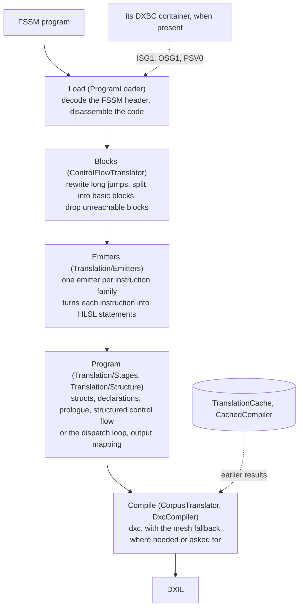
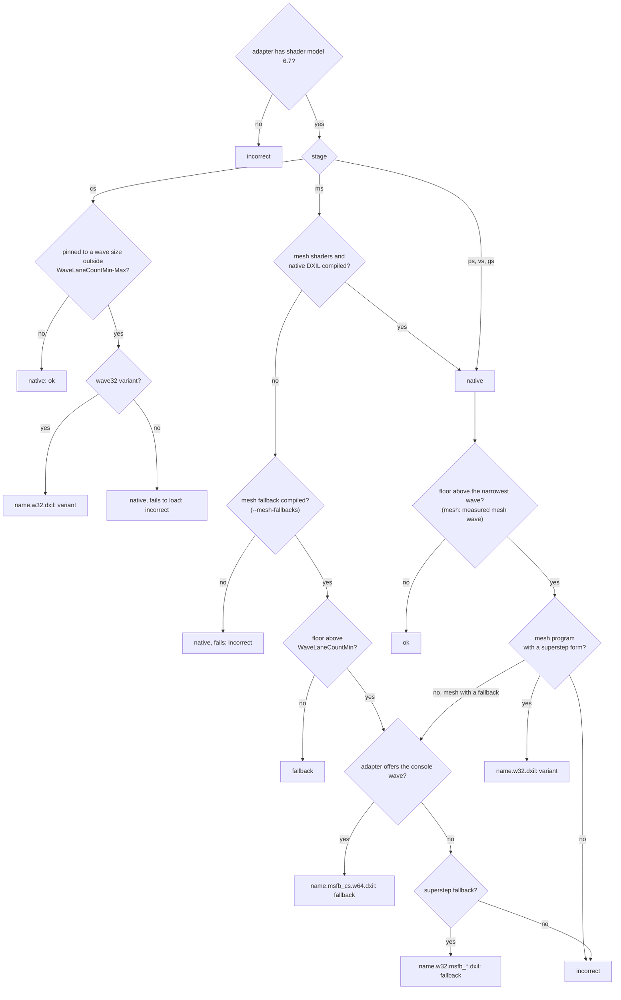

# Shader translation

`src/FiveStar.Shaders/Translation` turns a native RDNA program (FSSM, see [fssm.md](fssm.md)) into HLSL for shader
model 6.7. Public entry: `HlslTranslator.Translate(ShaderProgram) -> TranslationResult`.

## Pipeline



The container is read from `<fssm folder>/../dxbc/<name>.dxbc` (see Disassembly and Cache).

## Disassembly

`RdnaDecoder` (`src/FiveStar.Shaders/Disassembly`) decodes RDNA 2 code in-process. The emitters parse instruction
text, so the decoder prints every instruction exactly as llvm-objdump does for gfx1013 (wave64 lane masks as with
`+wavefrontsize64`), branch targets appended as `@T0x<target>`. It also keeps the listing's quirks: a dword that is no
instruction is `.long 0x...`, a run of 8 or more zero bytes is left out, and an instruction llvm-objdump lists with an
alignment warning is dropped, as the listing parser drops that line. A VOP3 source the instruction does not read
may hold 0 or the inline constant 0 (llvm-mc 23 writes the latter, older releases the former); any other value makes the
dword `.long`. Opcode numbers and field layouts come from AMD's
"RDNA 2 Instruction Set Architecture" reference guide.

`LlvmDisassembler` (llvm-mc wraps the bytes in an object file, llvm-objdump lists it, `ObjdumpParser` reads the
listing) is the reference: `fivestar shader decode-check` compares both on every program of a folder, and
`--llvm-disassembler` makes `disasm` and `translate` use it.

```
fivestar shader decode-check <fssm-folder> [--jobs N] [--limit N] [--step K] [--llvm <folder>]
```

Prints the program, code block and instruction counts and the first difference of each mismatched program; exit code
1 when any differ. On the 25,884 programs of the dump no program differs.

## Execution model

- One HLSL invocation is one GPU lane. Every SGPR and VGPR is a `uint` variable (`s4`, `v7`, `s_vcc`, `s_m0`, `s_exec`).
- EXEC is the per-lane bool `active`. A VALU result that only calls arithmetic and conversion functions is written
  `v = select(active, (uint)(value), v)`, straight-line code (`PureExpression`); other VALU and memory results are
  written `if (active)`; stores and atomics are guarded. EXEC stays a lane mask after an integer write (`active` is
  refreshed from the bits), so saving and combining it later is bool logic, not ballots.
- A lane mask held in SGPRs (v_cmp results, saved EXEC) is a per-lane bool `m_sN`; v_cmp writes `active && cond`.
- A lane mask used as an integer (`s_bcnt1`, `s_ff1`, stored, compared) is rebuilt with `WaveActiveBallot` /
  `WaveActiveCountBits`; an integer SGPR pair used as a mask is tested with `lane_bit(lo, hi)`.
- Which form a register is in is tracked in emission order, not per path. A register that is a mask on one path and
  an integer on another (a loop's back-edge block `s_and_b64 exec, s[12:13], s[80:81]` reads the saveexec mask of the
  loop's end, while its last write in program order is an `s_buffer_load`) would be read in the wrong form, so a first
  translation finds such registers and the second keeps them in their integer variables: each mask write also sets
  them with a ballot, and mask reads test them with `lane_bit` (cases `cs_mask_on_taken_path`,
  `cs_integer_on_taken_path`). On wave64 the high dword of every mask is set this way too. The first translation
  records, per block, the form each read assumed and each write left (`MaskForms`); `MaskFormAnalysis` carries the
  forms each register may hold from block to block along the branches (registers not yet written are integers) and
  keeps only those a read may reach in the other form. A register used as an integer in one part of a program and as
  a mask in another stays a plain bool (`cs_mask_after_integer`). Before, any register ever used both ways was kept in
  its integer variables: on `CS_ScreenProbes_ActivateProbes` (wave64) that was 33 of its 34 masks; now one is (s0,
  also a `s_getpc`/`s_setpc` address), and its HLSL goes from 32,393 `vw_ballot` and 20,976 `lane_bit` to
  17,411 and 2,167.
- SCC is the bool `scc`, set by compares, logic, carries and shifts as the hardware does.
- Registers read before any write are hardware inputs, assigned in a prologue (rules in [fssm.md](fssm.md)); a read
  outside the input layout is 0.

## Control flow

Every branch condition is scalar (SCC) or a wave-wide reduction (`execz`/`vccz` become `WaveActiveAnyTrue`), so all
lanes of a wave follow the same path and divergence lives only in `active`. Block leaders are the entry, branch
targets and the instruction after a branch or an early `s_endpgm`; blocks not reachable from the entry (constant tables
after the last `s_endpgm`) are skipped. A program without branches is emitted as straight-line code.

**Dispatch form** (`--dispatch`, `TranslationOptions.StructuredControlFlow` false). Blocks become `case`s of a
`switch (pc)` inside `[loop] for (uint pc_steps = 0; pc < PC_YIELD && pc_steps < ...; pc_steps++)` (see Loop guard);
each block ends by setting `pc` (`PC_END` after `s_endpgm`).

**Structured form** (the default). The blocks become nested statements:

| Graph shape | HLSL |
|---|---|
| Natural loop (back edge to a header that dominates its source) | `[loop] for (;;) { ... }`; back edge = end of body or `continue`, edge out = `break` |
| Loop with several exit targets | `uint loop_exitN` set before each `break`, tested by an if/else chain after the loop |
| Conditional branch | `if`/`else` whose arms end at the branch's immediate post-dominator |
| Arms that leave the loop on some paths | the join is the post-dominator once the edges out of the loop are set aside; the leaving arm ends in `break` |
| Arms that end the program on some paths | the join is the post-dominator once small exit tails (at most 64 lines that only lead to the end, such as a kill-and-end block) are set aside; the tails are copied into each arm |
| Arms that never join | the smaller ones inside the `if`, ending in `break`/`continue`; the largest after it |
| Early end outside every loop | `break` out of a `do { ... } while (false)` around the body |

A block reached on paths that do not join before it is copied into each path. When the copies make a scope (the top
level or one loop body) more than 1.5 times its own lines plus 256, or nesting passes 120 levels, that scope is
emitted guarded instead: `uint flowN` holds the number of the node to run, and the scope's blocks follow in
topological order, each as `if (flowN == k) { ...; flowN = <successor>; }`, so one pass runs one path; loops nested in
it stay structured. A two-phase mesh shader keeps its phase loops and `[loop] while (pc < PC_YIELD) switch (pc)`, with
one case per region (the entry and each resume point after a barrier) holding the structured code up to the next barrier
or the end; WARP's shader compiler crashes when the `while` is left out.

An irreducible graph (a cycle entered at more than one block) is first made reducible by entry guards
(`EntryGuards`, LLVM's FixIrreducible): each such cycle gets one header, a chain of tests on a selector
`uint irr_entryN`, and every edge into one of its entries sets the selector to that entry in a block of its own and
goes to the header. The cycle becomes one loop; the rest of the program stays structured, and the function opens with
`// control flow: N cycle(s) entered at several blocks, each given one entry guard`. The search takes the strongly
connected components of the program, guards those entered at several blocks, and searches each component again
without the edges back to its header, so cycles nested in loops are found too. 1 of 900 sampled programs needs it,
but those are large: on the RX 7800 XT, a culling compute program compiled in 8.2 s instead of 22.4 s (DXIL 245 KB
instead of 482 KB) and a raymarch one in 2.2 s instead of 7.5 s (161 KB instead of 319 KB). The same program in the
dispatch form costs the driver about three times the time of the structured form (1.7 s against 4.7 s, 3.3 s against
9.3 s) and up to seven times the memory.

The whole program keeps the dispatch form, with a comment `// control flow: dispatch loop (<reason>)`, when its graph
has a loop that never exits (`loop without exit`; DXIL requires every loop to have a break). Each thread runs the switch on its own there,
so an s_barrier inside it keeps only its memory fence (`GroupMemoryBarrier`): a thread that ended or sits in another
block never reaches the barrier the others wait in, and the group would hang (the console's s_barrier waits only for
waves that have not ended; XCL counts live waves, VIctory keeps the fence where not every lane reaches the barrier;
facts only). 4 of 400 sampled compute programs hold such a barrier; the cost is ordering across waves there.

Structured is the default since the control-flow differential (see Testing) ran both forms of real programs side by
side: their outputs are equal apart from fast-math rounding in dxc.

### Loop guard

Every loop is bounded (`LoopGuard`): every iteration of a structured loop spends one of the invocation's
`loop_budget`, and once the stage's cap is spent each loop leaves at its next iteration through `break` (a loop with
several exits then takes the one numbered 0). The dispatch `while` stops after 256 blocks per allowed iteration (2^24
for compute, 2^20 elsewhere; 2^24 for every stage before). A console program's loops end
on the data the console gives it; on the PC one wrong input keeps a loop going until the driver removes the device.

The console has no cap, so a cap is only a safety net against our own wrong inputs and must not bind for a correct
program. It keeps the device alive, not the output right: a hit is a bug to fix where the wrong input or
translation comes from. So every hit is counted (`loop_cap_hit`, once per wave, in dword 3 of the program's slot of
the window guard's cap table, beside the superstep block and round caps) and the loader names the programs at each
captured present (`[window guard] present N: K programs ran into a cap`). The caps count all loops of one invocation together (a cap per loop let nested loops multiply it, 65,536² in
`CS_InitDepthPyramidWithCpuOcclusion3x3`):

| Stage | Cap | Why |
|---|---|---|
| pixel, vertex, geometry, mesh | 4,096 | invocations come by the million a draw. A Series X frame at 30 fps is about 2·10^11 lane instructions; a full-screen pass of 3.7 M pixels at 4,096 iterations of a 4-instruction loop would take a third of it, so a correct program stays far below. A runaway draw stops after about 1.5·10^10 iterations, well under the driver's 2 s timeout on a 4090 |
| compute | 65,536 | a thread is one of fewer, and single-thread passes walk whole lists |

`TranslationOptions.Loops` (`LoopCaps`; the loader's `--loop-caps`) replaces these per stage: `victory` is
victory-gta6's 4,096 compute, 256 vertex and mesh, 128 pixel, and also bounds the dispatch form at 256 blocks per
allowed iteration; `compute,geometry,pixel` gives other numbers. The caps are part of the translation options, so of
the program cache identity. The superstep form had no bound at all; it now ends a thread that has run 2 blocks per
allowed iteration (`ss_steps`, `LoopCaps.SuperstepSteps`: 8,192 for mesh), which then meets every later barrier as
an ended thread. A loop with no wave operation (a scalar count loop) stays inside one round, so the round bound below
never sees it; with the dispatch form's 256 blocks per iteration (2^20) the loop of `MSNC_VS_LinearDepthSkin_f1f2249c`
over a constant-buffer count (dword 0x11c), a sample and about thirty dependent loads per pass, could run 2^20
passes per thread, the likely cause of the w39 and w40 removals.

A mesh program's group rounds are bounded too (`LoopCaps.Rounds`: 1 per allowed iteration, 4,096 for mesh by
default, 256 with `victory`): the barriers of the two-phase form (`ms_step`) and the steps of the superstep form
(`ss_rounds`). A console loop around an `s_barrier` runs one round per iteration and no structured loop counts it,
so a garbage trip count held the group: w31's ExecuteIndirect DispatchMesh(4, 1, 1) of
`MSNC_VS_LinearDepthSkin_f1f2249c` never finished (DEVICE_HUNG), and before that the superstep form ran up to 2^24
rounds. Every thread counts the same rounds, so all leave on the same one. A program cut off there culls its primitives
(`MeshDeclarations.CutEpilogue`), so nothing it never wrote is drawn; WARP's rasterizer crashed on such outputs.
The bound is a time bound: on the RTX 4090 a superstep round of `MS_VS_TransformTerrainNormalTint_e74ae427` in
DispatchMesh(94, 1, 1) took 40 to 60 us (256, 1,024 and 4,096 forced rounds: 0.36, 0.41 and 0.59 s with the pipeline
built), so the earlier 16 per iteration (65,536 rounds) ran 3 to 4 s, past the 2 s GPU timeout: the DEVICE_HUNG of the
mesh ExecuteIndirects in boots w31 to w47 (LinearDepthSkin, PropFoliageSkinDeferred, TerrainNormalTint). A light superstep
block costs about 0.6 us a thread, but LinearDepthSkin's layer loop (a sample and about thirty dependent loads a pass)
ran the earlier 2^16 blocks of `ss_steps` in 0.5 to 1.5 s per DispatchMesh in w49, and frames passed the game's 30 s
hang watchdog; 2 blocks per iteration (8,192) take about 0.1 to 0.2 s. TransformSkinTransmission
(no loops) ran to its end on zeroed inputs on the 4090 with both compilers, so the superstep structure itself holds.

A direct-export mesh program (two-phase or superstep) starts every primitive of its count as the degenerate triangle
(0, 0, 0) with its SV_CullPrimitive false right after SetMeshOutputCounts, and an export culls a primitive whose
indices pass the vertex count and keeps them inside it: uninitialised or out-of-range primitives hung NVIDIA's mesh
pipeline (VIctory #587). The cull starts false, not true, because AMD's driver (RX 7800 XT) keeps a primitive culled
once its cull was written true: the export's later false was lost, and every mesh pass drew nothing there (the mesh
cases of `MeshShaderTests` drew no pixel with `FIVESTAR_TEST_ADAPTER=hardware`); a later true, such as the cut
epilogue's, is kept.

The superstep form first drops the wave operations whose result nothing reads (`DeadWaveOperations`: a ballot into an
SGPR half or an scc write that is dead after it, by liveness over the block graph), after reading a lane's own bit of a
ballot from the mask bool it took (`BallotBits`: `lane_bit(lo, hi)` of `vw_ballot(m).x` and `.y` is `m` while
neither half nor `m` is written, since every thread of the console wave deposits its bit; a wave32 program needs only
`.x`, so its `lane_bit(lo, 0u)` of a 32-bit mask such as `s_cselect_b32 s8, exec, 0` counts too, which took
`CS_PedStandardSkinning` from 57 ballots and 115 `lane_bit`s to 20 and 50; the block's exit condition, which the
structured form branches on, is rewritten with its lines, case `cs_vcc_loop_exit_w64`). Over the 8,765 mesh
programs the stops fell from 1,340,858 to 406,824; none has more than 500 left (207 had before), and
`MSNC_VS_LinearDepthSkin_f1f2249c` went from 611 to 180. The other forms drop them too (pixel programs without the
own-bit rewrite, since helper lanes take no part in an HLSL ballot): dxc keeps an unused `WaveActiveBallot`. In every
40th mesh, pixel and vertex program the ballots fell from 29,486 to 818 (mesh) and 30,499 to 8,252 (pixel and vertex),
the `vw_any`s from 40,389 to 17,276; `MS_VS_Transform_PositionOnly_8d8b5e7b` went from 75 to 23 ballots and 4,623 to
4,359 DXIL instructions. A mesh yield (s_barrier) resumes with every register kept, so liveness crosses it.

One round then serves every ballot, `vw_any` and `vw_count` of the mask the last round took, until something that mask
reads is written or the block ends (`SuperstepSplitter`): the round's mask buffer holds the whole ballot, so a ballot's
`.y` no longer takes a round after its `.x`. Up to four readfirstlanes of one mask in a row (a waterfall loop reading
a descriptor's dwords) also share one round: each thread deposits the four values (`vw_ss_put_values`, with
`VW_SS_VALUES 4` in the program) and reads value k of the first lane (`vw_ss_first_value`). Over the 8,765 mesh
programs the stops fell from 406,824 to 316,397 with the shared ballots and to 299,243 with the shared readfirstlanes;
the most any program has went from 449 to 284, and none has more than 300 (48 had). `MS_VS_TransformD_c5fd36bb`
(049945c2), whose pipeline the driver did not build in 10 minutes, went from 393 stops to 234 (1,291 to 973 cases); its
remaining rounds are mostly the 192 branches on "any lane" of a mask.

Before the cut, wave operations whose result every lane of the console wave already holds take no round
(`UniformWaveOperations`, from the window analysis's console-wave facts, `WindowAnalysis.EntryFacts`):
`readfirstlane(x)` of a value equal on every lane (or on every active lane under a full EXEC) is `x`; `vw_any(m)` of a
mask equal on every lane (or EXEC and a uniform value under a full EXEC: a scalar condition as a mask) is `m`; and a
branch on "any active lane" whose path, run with no lane active, changes nothing read where the paths meet
(`SkipRegion`) enters the path always, as the console does whenever a lane is active (never a loop's exit test, nor a
path holding a loop: with no lane of the console wave active, a loop whose exit reads lane values never ends;
`vfx_triangleClip~CS_DefragHeap_ComputeRelocations` ran to its round bound every frame that way, w98). In
every 4th mesh program the 621 that take the superstep form went from 23,912 stops to 11,663 (each fewer; the most
from 186 to 130); `MS_VS_TransformD_c5fd36bb` 018ec975 from 25 to 11 and 049945c2 from 144 to 82. Those programs need
whole console waves because `readfirstlane` takes a per-lane value: TransformD reads its vertex and primitive counts
(GS_ALLOC_REQ's m0, and every lane's export test) from the first lane's meshlet record, indexed per lane by instance,
equal across the wave only by the data.

The same rewrite runs on the superstep form of compute programs, where each such operation is a group round too, and,
for the values only (no skips: a branch costs less there than running the path), on the native mesh form, where an
emulated readfirstlane is a ballot and a lane read. Compute and the other stages read their per-lane inputs under other
names (`in_gtid`, `in_vid`, `in_pos`, ...), which the analysis now treats as lane values; before, an unknown name read
as its declared value, equal on every lane. `CS_ShadowRenderTiledCascadesCBPPPC`'s superstep form went from 831 stops
to 216, 1.89 to 1.54 MB of DXIL (with if-conversion), and its RTX 4090 pipeline from 4.2 to 2.7 GB peak memory (81 s
either way). In every 4th mesh program (2,192) the native forms' readfirstlanes fell from 32,014 to 14,834 and their
`vw_any`s from 68,732 to 66,814; no floor changed (1,833 at 4 lanes, 359 superstep forms with 9,311 stops, which had
the rewrite before).

A two-phase mesh program the window analysis holds back that way now exchanges those values instead
(`FirstLaneExchange`): a v_readfirstlane under a full EXEC before GS_ALLOC_REQ becomes a deposit by console lane 0
into groupshared memory, a yield to the group's barrier step and a read of lane 0's value by every thread of the
console wave (slots alternate with the step's parity). It is kept only when the analysis then passes, and the result is
the console's whether the windows' own first lanes agree or not, so no runtime check or second body is needed. In
every 4th mesh program 255 of the 625 with a floor of 64 drop to 4, each with 3 exchanges (the thread id and the two
counts), for three group barriers in place of the superstep form; their native DXIL grows 9 to 29% (12 sampled), but is
smaller than the superstep form 32-lane GPUs compiled before in 11 of 12 (TransformD 018ec975: 105 KB native and
140 KB superstep, now 117 KB native only). The thread id needs no exchange: under a full EXEC the console's first lane
is the console wave's first thread, `in_gid.x * N + (in_gi & ~(VW_WAVE - 1))`, when no line on a path to the
readfirstlane writes the register after the prologue; that leaves two exchanges (257 programs, DXIL 1 to 7% below the
three-exchange form). With EXEC full a guarded write is every lane's write, so the analysis keeps its value's facts.
No exchange may lie in a region windows decide for themselves or after one that holds a yield
(`WindowAnalysis.Divergent`, `FirstLaneExchange.Converged`): a window that skipped a yield would meet it a round late.

A superstep program names its cost in its first body line, `// superstep: <stops> stops, round bound <n>` (the loader
logs it once per program): a round is a group barrier and a run of the dispatch switch to the next stop, so a large
program's rounds can outlast the driver's timeout well before the caps' bound (`MSNC_VS_LinearDepthSkin_f1f2249c`:
1,218 stops, a 1.27 MB DXIL, DEVICE_HUNG on its first DispatchMesh(4, 1, 1) on the RTX 4090).
`TranslationOptions.RoundsPerStop` (the loader's `--superstep-round-budget <k>`, off by default) bounds the rounds at
k per stop (at least 256) when that is lower; a program cut there culls its draw.

Lower caps cut correct programs short, not only runaways. In the 25,908-program corpus 4,816 of 12,067 pixel programs
have loops, 1,251 of them ten or more, whose iterations all count against one cap; 1,944 of 2,689 compute programs and
1,366 mesh programs have loops. No static trip count is known for most of them (their bounds are loaded data), so
`victory` is a diagnostic setting for hangs, not a default.

victory-gta6 caps each loop at 128 (pixel), 256 (vertex, mesh) and 4,096 (compute) and kills the lane at the cap. Those
values can cut real loops (light lists, blur kernels); ours trade a little more GPU time for not doing so.
`--trace-pool-stores` logs the first hit per program with the loop's number and the cap. The previous lanes' boot logs
show hits only in programs reading wrong data (`CS_InitDepthPyramidWithCpuOcclusion3x3`, below). The caps are literals
in the HLSL, so every cache keyed on the text or on the translator keys on them. In the story load, `InstanceCulling~CS_Prop_BatchCull` (counted loops that
end when a counter equals a bound read from a buffer) and then `scattering_transmittance_system~CS_DensityShadowMapCheckerboard`
(a ray march whose float step counter, incremented by 1.0, must reach a step count converted from a float) never
finished. The guard turns such a hang into wrong output for that dispatch. In CS_DensityShadowMapCheckerboard and
CS_SkyRadianceCache the cause was the translator: the loop's back edge read its saveexec mask as an integer an
earlier load left (above, lane masks), so lanes still in the loop fell out of EXEC and never left it. With that fixed,
`depth_pyramid~CS_InitDepthPyramidWithCpuOcclusion3x3` runs its loops as written and reaches the guard: dwords 2 and
3 of its first constant buffer are 0, so its row and column bounds are `v_rcp` of 0 (+inf, converted to 0xffffffff).
`MS_VS_PropFoliageDeferred_7cf79608` ran into the superstep round bound (boots w71 to w74b) for the same kind of reason:
its loop ends a lane with `v_cmpx_eq_u32_sdwa s31, v85 src1_sel:BYTE_0` (counter == the count in byte 0), and the SDWA
emitter took the first operand of a v_cmpx for a destination, so it compared the whole dword and the lane never left.

`s_getpc; s_add_u32/s_sub_u32; s_addc_u32/s_subb_u32; s_setpc` on one register pair is a long branch and becomes a
static branch to the `s_getpc` address + 4 + C. Other `s_setpc`/`s_swappc` (indirect jumps) are not supported, except
the fetch-shader call at a vertex shader's entry. When the pair and SCC are dead at the target (every path writes them
before reading them; `DeadJumpRegisters`), the s_getpc, s_add and s_addc become s_nop: a remaining s_getpc makes the
program read its own code, so every s_load checks for a code pointer and the code becomes a table in the program.
`indirect_diffuse_lighting~CS_ScreenProbes_ActivateRays` (76,697 instructions, 1,377 long jumps, 4.5 MB of DXIL) lost
its 333 KB code table and 10,041 such checks: 9.33 to 7.23 MB of HLSL. Its size is otherwise its own: no superstep,
dispatch form or emulated waves (a 32-lane pinned compute program); its top level is the guarded form (13,834 blocks
under `if (flowN == k)`), which copies no block.

Three programs of the dump (`CS_RTShadowTrace32HQ_Tiled`, `CS_RTShadowTrace32TemporalHQ_Tiled`,
`CS_RTShadowTrace32TemporalHQ_OneOver8RPP_Tiled`) end with a backward long jump whose C is 8 too large, as if measured
from the end of the `s_sub_u32`. It lands on the `s_branch` of `s_cbranch_execz L; s_branch FAR`, re-entering the code
that holds the jump: a loop without exit, which hangs the wave on the hardware. Every other long jump of the same shape
returns to L. When C measured from the end of the `s_add_u32`/`s_sub_u32` gives exactly that conditional branch's
target L, the jump goes to L (the three programs then translate structured).

## Resources

The D3D12.X layer creates the views and samplers, so it decides what descriptor memory holds:

| Descriptor | Meaning in translated code |
|---|---|
| T# dword0 | `ResourceDescriptorHeap` index |
| S# dword0 | `SamplerDescriptorHeap` index (`sampler_slot`: at most the heap's last); an S# built from literal constants gets the slot its words and use give (`StaticSampler`, from `STATIC_SAMPLER_BASE`) and is listed at the top of the program; one with FORCE_UNNORMALIZED or FORCE_DEGAMMA set (applied in the shader; none in the corpus) refuses the program. An S# loaded through a 32-bit pointer (the s_load dword an image instruction samples with, `SamplerLoads`) reads the sampler heap's records (`SamplerPtrLoad`): pointers are relative to their own heap, each based at 0, and Scaleform's FTexTG programs read their S# at a root constant + index × 16 |
| T# / V# dword0 heap index | `view_slot` / `uav_slot`: an index past the desktop view heap names the null SRV or UAV of unmapped pages. A texture goes through `tex_slot` (`NullTextureSlots`): an index below `FIVESTAR_FIRST_GAME_VIEW` (the loader's 21: the reserved buffers 0 to 9, then a null SRV per dimension and a null UAV per writable one at 10 to 20) or past the heap reads the null texture of its own dimension, never a buffer as a texture (a zero T# named the raw window at slot 0; XCL reports a zero T# indexing slot 0 hung NVIDIA). Without the define (offline) only the heap's end applies |
| V# base (dword0, dword1 bits 0-15) | a console GPU address, found in the address map (`buf_view`): the D3D12.X shim's records of read-only buffer views of game memory hold the view's address as the console's do, so a program can build pointers from it; base_hi 0: dword0 is a heap index (records of buffers the desktop placed, or `--buffer-records-heap-index`) |
| V# dword1 bits 16-29 / dword3 | stride (idxen) / hardware format word: gfx10 unified format (bits 12-18, decoded by `buf_code`) and destination swizzle (bits 0-11, `fmt_swizzle`, loads only) |
| 64-bit pointers (`s_load`, `global_*`) | high dword 0: byte address in the window `ResourceDescriptorHeap[GPU_MEM_HEAP]` (writable view at `+ 1`); otherwise a console GPU address in the address map (`PtrLoad`, `PtrStore`, `gpu_rw`). Scalar loads (`s_load`, `s_buffer_load`) read their views through `NonUniformResourceIndex`, each dword through the map (`SPtrLoad`, `SBufLoad`; `SPtrLoadAt` reads as `SPtrLoad`), although their address is in SGPRs: on an RX 7800 XT the uniform form ended every boot of a retail game in a device hang with a page fault 1,200 to 2,000 presents in, and a non-uniform index through `SPtrLoadAt`'s select of two views crashed the AMD compiler (see the prelude), and an `s_load` of several dwords walks the map once per load (`sptr_views`: its first byte's page and the next one, as 64 bytes span two pages at most; `SPtrLoadAt` picks each dword's page with selects, no branch per dword): the G-buffer pixel programs read 84-1,064 scalar dwords per pixel against 3-55 samples. Offsets are added in 64 bits as the hardware does (`ptr_add`: the unsigned VGPR offset and the signed instruction offset carry into or borrow from the high dword); before, a carry out of the low dword was dropped and the access landed 4 GiB lower |
| `s_getpc_b64` pointers | high dword `CODE_TAG`; loads read the program's own code, emitted as `g_code[]`; a per-lane (vector) load indexes only the code words from the earliest table the program's s_getpc pointers are moved to (each s_getpc followed by `s_add_u32`/`s_sub_u32` of its low half; `g_data[]`, `CodeData`): indexed per lane, the whole code array cost the AMD driver 26 s and 1.9 GB for one tiled-lighting pixel program, its 53 table words 14 s and 0.5 GB. Lanes read at or after the table they point to (an address before it reads its first word). When one s_getpc is used otherwise, or there is no table, the loads keep `CodeLoad` and the program is unchanged |
| BVH T# | dword0 = BVH base address >> 8 in the memory window (see [ray-intersection.md](ray-intersection.md)) |

**Wide stores.** A compute program's store of 2 to 4 dwords a lane (`buffer_store_dwordxN`, `global_store_dwordxN`) goes through `BufStoreN` / `PtrStoreN`: when the whole hardware wave stores into one view and each lane's record follows the one before, the wave writes the block a dword a lane (store k writes dword k * lanes + lane, read from the lane holding it), else each lane its own dwords. Game memory is system memory, where the GPU stores whole sectors fast only a dword a lane: on an RTX 4090, 4 MB of 16-byte lane records took 25-40 ms, 0.6 ms written this way, 0.16 ms a dword a lane. Off with the store and span traces.

The **address map** (`ResourceDescriptorHeap[GPU_MAP_HEAP]`, slot 7; `AddressMap` writes it) holds a dword per 4 GiB
span of the address space (the address's high dword) naming the span's page table, and per 64 KiB page the heap index
of a raw SRV over the page (its UAV follows) and the page's byte offset in that view. Every access is looked up at its
own address, added in 64 bits: base + offset for a V# (`buf_view`), the pointer plus its offsets for `global_*` and
`s_load`. The hardware translates each page, so the pages after a V#'s base need not continue its view (a neighbouring
buffer, or frames the game remapped); an access's later dwords continue in the view of its first byte's page. Lanes
of one wave can reach different views, so the heap index of each such access is `NonUniformResourceIndex`. The
D3D12.X shim fills the map from its address table ([d3d12x-shim.md](d3d12x-shim.md#binding)) and from the XMem page
tables: a mapped XMem page names a view over the section that holds its frame, rewritten on every remap
([physical-memory.md](physical-memory.md#the-streaming-pool)); an address it does not know names a null view and
reads 0.

**Range checking.** Buffer accesses keep the RDNA rule: out of range, a load reads 0 and a store or atomic is dropped
(an atomic returns 0). Console programs rely on it: an argument or append writer runs past its allocation, and a loop
reads zeros past an end. Without it, those stores landed through the address map in the game memory next to the
buffer. One of the places they landed was the transient pool's block-end nodes, which caused the story-load faults at
0x144e9b4b2 ([debugging.md](debugging.md#transient-pool-watch)). The hardware adds index * stride to the base without wrapping, so an index of -1 (a counter at 0) lands 4 GiB away and is dropped; the translated address is a 32-bit offset into a view, where the same product wraps to one record below the base, inside the game's whole-pool raw view (OOB_SELECT 3 does not check the index). An access whose index * stride reaches 4 GiB is out of range in every mode (`buf_limit`); before, 20-byte records of index -1 overwrote the transient pool's block-end nodes.

The rules follow OOB_SELECT (V# dword3 bits 28-29) as measured on RDNA1 (gfx1011) and RDNA2 (gfx1036) hardware
(Leonida's docs/buffer_bounds.md, Mesa's GFX11 column). num_records is dword2; the offset is the VGPR offset plus the
instruction offset. Every access below is one dword:

| OOB_SELECT | Out of range when |
|---|---|
| 0, structured | index ≥ num_records, or offset + 4 > stride |
| 1, structured | index ≥ num_records |
| 2 | num_records = 0 |
| 3, raw | offset + soffset + 4 > num_records; index × stride moves the address but is not checked |

A format access (`buffer_load_format`, `tbuffer_*`) checks its element instead of a dword: 4 above becomes the format's
size, 1 to 16 bytes (`fmt_limit`). With the dword check an R16 structured buffer of stride 2 failed every access and
read 0; the mesh probe of `MS_VS_Transform_PositionOnly` found one format load out of range in 2,876 of 2,895 groups.

Per access, `buf_limit` gives the end the dwords must fit under and `buf_offset` the checked offset (soffset counts
for raw V#s). Each dword then costs one compare (`buf_fits`); formatted accesses check the element's first dword.
A `buffer_load/store_dwordx2-x4` makes one compare when all its dwords are in range (`buf_fits_all`: the last fits and
its offset does not wrap) and then one `Load2-4` / `Store2-4` through one descriptor (`BufLoadV`, `BufLoadRWV`,
`BufStoreV`, and `BufStoreN` in compute); partly in range, a rolled loop checks and moves each dword as before
(`BufStoreEach` for stores). On `CS_PedStandardSkinning` that took the DXIL backend's output from 281,224 to 267,040
bytes (1,395 to 1,135 raw loads, 481 to 283 raw stores, 793 to 333 heap handles) with the same replay outputs. `s_buffer_load` keeps a select
per dword: those loads are uniform and branch-free, and a range branch per site grew the constant-heavy programs.
The shim's records carry the OOB_SELECT of their view's kind (raw 3, structured 0, typed and constant buffers 1).

Audit against the GFX10 rules, per access kind (the corpus's 25,885 programs as a census; `ComputeBufferRuleCases` has
a WARP case per rule):

- Dword loads and stores (`buffer_load/store_dword*`, most of the corpus's vector buffer accesses): each dword is
  checked on its own, so a dwordx2 whose second dword passes the stride keeps its first. The hardware measurements
  behind the table were of single dwords; whether OOB_SELECT 0 checks a multi-dword access whole is not measured.
- soffset counts for raw V#s only; a structured access checks its VGPR and instruction offset against the stride.
- Format accesses check the format's element (above); their d16 forms (`buffer_load_format_d16_x`, `_d16_xyzw`,
  `buffer_store_format_d16_xyzw`: 1,156 instructions) carry halves, two per VGPR: an integer format's low 16 bits,
  any other format as f16 (`fmt_half`, `fmt_unhalf`); `_d16_x` and `_d16_xyz` keep the other half of their last VGPR.
  Before, they were read and written as one component per VGPR, clobbering the VGPRs after them.
- Atomics are one dword each (no `_x2` forms in the corpus: they and byte or short buffer accesses are refused).
- `s_buffer_load` checks each dword's start against `sbuf_limit` and ignores OOB_SELECT.
- Swizzled V#s (ADD_TID_ENABLE, the index stride) are not modelled: the driver's rings use them, the game's V#s do
  not set them as far as traced.
`s_buffer_load` compares its whole offset with `sbuf_limit`: num_records in bytes for stride 0, else num_records ×
stride.

The other memory paths, the same way (opcodes counted in the corpus):

- Image atomics with dmask 0x3 (0xf for cmpswap) are 64-bit: `image_atomic_umax v[0:1], ... dmask:0x3` on an
  R32G32_UINT texel (974 instructions) is a max of the 64-bit value v1:v0. They were translated as 32-bit atomics on
  the low dword; they are `uint64_t` typed atomics now (SM 6.6, the device's AtomicInt64OnTypedResource), on the
  R32G32_UINT view. The DXIL backend lowers them as an i64 `atomicBinOp` on a uint64_t texture, with the shader flags for 64-bit atomics on typed and descriptor-heap resources, as dxc does (`cs_image_atomic_64`; 679 alpha-prepass programs of the corpus); other 64-bit texel access it refuses.
- Image loads, plain gathers and stores declare their texture `float4`, which leaves an integer view's bits undefined
  (D3D12 matches the declaration to the view format). With `--typed-image-views` (`TranslationOptions.TypedImageViews`,
  part of the program cache identity) the loader writes each texture view's component class in dword 3 of its record
  (0 float, 1 uint, 2 sint: `ImageViewClasses`; the main depth's stencil plane, X32_TYPELESS_G8X24_UINT, by which the
  lighting classifies pixels, is uint), and the read or write branches on it to a `uint4` or `int4` declaration of the
  same descriptor, the registers' bits passed through `asfloat`/`asuint`. A d16 load of an integer view keeps each
  value's low 16 bits instead of an f16. Class 3 is shared-exponent light: the game writes R9G9B9E5 bits into R32_UINT
  targets and reads them through R9G9B9E5 views, which no desktop view of an R32_UINT texture can be, so the view stays
  R32_UINT and a load decodes the bits (9-bit mantissas at 0, 9, 18, the exponent at 27: m * 2^(e - 24)), alpha 1. By default the loader instead points such a view at an R9G9B9E5 shadow of the texture, copied from it when it leaves a write state (`SharedExponentAliases`, after victory-fork; see `--no-shared-exponent-copies` in [loader.md](loader.md)), so the hardware decodes and filters it; class 3 remains with `--no-shared-exponent-copies`. Samples filter and stay `float4`; a compare gather and a gather at a level
  too. A record without a class (no desc, a view copied in from a desktop heap) reads as float, as before.
- LDS byte and short accesses and their d16 forms (`ds_read_u16`, `ds_read_u16_d16_hi`, `ds_write_b16`,
  `ds_write_b16_d16_hi`: 110 instructions) read and write the right half (`cs_lds_d16_hi`); `global_load_ushort` (6) too.
- Image loads and samples read every texture as `float4`, and their d16 forms pack `f32tof16` of it. An integer
  texture read with d16 (1,500 `image_load ... d16`, format unknown statically: the T# records hold only the heap
  index) would need the integer's low 16 bits instead; not changed.
- `s_load` and `global_load` look every dword up at its own address, so a load across a page reaches each page.

soffset matters: the meshlet culling kernels (`CS_BatchCullBatchCSMeshlets` and its siblings) take argument slots with
`buffer_atomic_add v4, off, s[44:47], s11 glc`, addressing only through soffset (ThatRecompDev/five-star-recomp#3).
Loads use `select`, not `?:`. HLSL 2021 short-circuits `?:`, and the branches around each load raised dxc time by
50 to 300 % on the heaviest programs. With `select` the overhead is about 0 to 40 % (three sample programs).
A buffer the program also stores to is loaded through its RW view (`BufLoadRW`). Cube sampling rebuilds a direction
from (s, t, face) with `cube_dir`.

Every V# is read as a `ByteAddressBuffer`, whether its record came from a fixed table slot or from an index the program
computed: the shim writes a raw SRV for a CBV in a game heap. victory-gta6's culling read a heap-picked buffer SRV as a
CBV and every meshlet draw ran empty; the same mix-up cannot arise here.

`image_gather4_l` (and `_o`) on a 2D texture or array: HLSL `Gather` has no level operand and reads level 0, so the
four texels are `Load`s at the rounded LOD (clamped to the view's levels), in gather order, each coordinate clamped to
the level's edge (the clamp address mode; the sampler's own mode is not known). Gathering level 0 culled most of the
world against the wrong depths in victory-gta6's meshlet culling. Other dimensions still gather level 0.

## Stages

| Stage | Entry | Inputs | Outputs |
|---|---|---|---|
| PS | `Out main(PSIn pin, SV_Position, SV_IsFrontFace, SV_SampleIndex, SV_Coverage, SV_Barycentrics)` (only those used) | attrN = N-th non-system ISG1 register, original semantics and types; `v_interp_mov p0` → nointerpolation; p10/p20 → `GetAttributeAtVertex` | mrtN → SV_TargetN with the OSG1 type, mrtz → SV_Depth (SV_DepthLessEqual / SV_DepthGreaterEqual, clamped to the rasterized depth, under CONSERVATIVE_Z_EXPORT); DEPTH_BEFORE_SHADER without a depth export → `[earlydepthstencil]` |
| VS | `Out main(SV_VertexID, SV_InstanceID[, FetchIn fin])` | fetch-shader attributes → `FetchIn` members `ATTR<n>` | paramN → N-th non-system OSG1 register; pos0 → SV_Position; pos1.. → clip/cull distances |
| CS | `[numthreads(x, y, z)] main(SV_GroupID, SV_GroupThreadID)` | group and thread ids | none; LDS → `groupshared uint g_lds[]` |
| MS | `[numthreads(n,1,1)] [outputtopology("triangle")] main(..., out vertices Out verts[], out indices uint3 tris[], out primitives MSPrim prims[])` | group id, group index | as VS; prim export → `tris` + `SV_CullPrimitive` |
| GS | `[maxvertexcount(n)] main(<prim> GSIn gin[], SV_PrimitiveID, inout <Stream><Out>)` | ISG1 registers | via the copy shader |

**Pixel shaders.** `active` starts as `!IsHelperLane()` and the entry has `[WaveOpsIncludeHelperLanes]`, so wave and
quad operations see helper lanes. An `s_wqm` of the initial EXEC straight from the entry (no branch, discard or other EXEC write before it; the body's `do { } while (false)` runs once) is `active = true` (`ProgramEmitter.WholeQuadEntry`): a quad runs only with a covered pixel, so every lane the GPU runs is in it, and the compiler folds the select of each vector write under it (the deferred G-buffer programs' DXIL shrank 6-12%). A run of four or more vector writes under EXEC whose values read no other lane (no wave, quad, sample or gather operation) is one branch, `if (active) { v = (uint)(x); ... }`, instead of one select per write (`ActiveRuns`): ps_light_proxy_conservative 8501a4a1 went from 5,924 such selects to 1,014 in 410 branches, its DXIL from 120,631 instructions to 115,056. The final export (`done vm`) discards lanes with EXEC clear. With primitive-ordered
shading (POPS) every writable view becomes `RasterizerOrdered*`, the exiting-wave-id wait passes at once and
`MSG_ORDERED_PS_DONE` does nothing.

**Packed f16 attributes.** A PS reading half of an attribute channel reads `ATTRLO<n>`/`ATTRHI<n>`; a VS with up to 10
params (a mesh shader with up to 2) also exports each param unpacked into those two halves.

**Linkage.** D3D12 links a VS and a PS by semantic and register, and dxc assigns registers in declaration order. A VS
declares its params in number order, then the unpacked halves; a PS declares every non-system ISG1 register, read or
not, then `ATTRLO<k>`/`ATTRHI<k>` pairs from 0 up to the highest half it reads. A pair compiled together by the game
then links. A VS that does not export every param of its signature still shifts the later registers.

Translated on its own, a producer does not link with every PS it runs with. The runtime compares semantics,
registers and masks (not interpolation modes), and on the console cache's pairs it fails three ways: dxc never packs
elements of different interpolation modes into one register, and a PS gives its inputs modes (`nointerpolation` for
flat and integer reads) the producer lacks, so two outputs sharing a register sit in two in the PS; the PS declares
`SV_Position` after its halves while a VS declares it before; and a PS declares inputs the producer does not export
(signature registers it never writes, f16 halves of a producer with too many params).

**Pair-time linking** (`StageLinker.Link(producerHlsl, psInputs)`) rewrites the producer's `Out` struct (VS, MS or
mesh-fallback VS) from the PS's PSV0 input elements: the members the PS reads come first, in the PS's order and with
its modes, then the producer's other outputs. dxc packs a prefix the same way in both stages, so every input lands in
the PS's register; the PS's own layout stays as described above. A PS input the producer lacks is added: an
`ATTRLO<k>`/`ATTRHI<k>` half is computed from the members of param k (where the producer fills `o`, or at each export
of a mesh shader that writes its outputs directly), anything else is 0. `fivestar shader link` applies it to the pairs
of the console pipeline cache (see Commands), and the loader to every pair the runtime would refuse
([d3d12x-pipelines.md](d3d12x-pipelines.md#linked-producers)).

A mesh producer linked to a PS's full layout can pass the 32 KB a mesh shader has for the outputs of its 128 vertices
(`PS_DeferredTextured` + `MS_VS_TransformD`: 9 registers, 8 halves and the position, 18 rows of 16 bytes per vertex).
`StageLinker.TrimInputs(psHlsl)` drops the `PSIn` members the PS never reads (registers kept only for the layout,
halves below the ones it reads); the producer is then linked to the trimmed PS.

**Mesh shaders (NGG).** `s_sendmsg(MSG_GS_ALLOC_REQ)` (M0 = primitives << 12 | vertices) records the output counts.
When every export follows a barrier that follows the allocation, the program runs in two phases: phase 1 without
output writes until that barrier, then `SetMeshOutputCounts` at top level, then phase 2 resumes and writes `verts`,
`tris` and `prims` directly. Phase 2 has its own barrier only when a block it can run (from the resume points after a
barrier) yields again: NVIDIA's driver (RTX 5070, 621.40) hangs the group (DEVICE_HUNG) on dxc's optimized form of a
program whose phase 2 carries a barrier it never reaches, while dxc `-Od` and the DXIL backend run it. A console
s_barrier waits only for waves that have not ended; a D3D12 group barrier waits for every thread. So a thread that
reached `s_endpgm` keeps meeting each phase barrier, counted out of `g_ms_live` (three rotating counters, as
`vw_ss_step`'s), and the loop ends when no thread runs. Phase 1 ends on GS_ALLOC_REQ's flag read after the barrier
and before a second one in the native form: read without it, a thread that resumed first could set the flag before a
slower one read it, the two left phase 1 at different rounds and the group hung. The superstep form keeps one barrier
per round: the thread that sends GS_ALLOC_REQ marks it in the step's own rotating buffer (`vw_ss_allocated`), which
every thread reads after that step's barrier. The loops of the looping mesh programs (`MSNC_VS_LinearDepthSkin`,
`MS_VS_TransformTerrainNormalTint`, `MSNC_VS_PropFoliageSkinDeferred`) all run before GS_ALLOC_REQ, in phase 1, so
their rounds had two barriers each. Otherwise
exports are staged in compact `groupshared` structs (at most 28 KB with LDS) and copied out after the loop. A
primitive export holds three 9-bit indices at bits 0/10/20; bit 31 culls. Thread index code uses a virtual wave64 lane
(`in_gi & 63`).

**Geometry shaders (legacy GS).** One HLSL invocation is one lane with a private `static uint g_lds[]`. The input
vertices are written at `GS_IN_BASE` (register r component c at dword r × 4 + c, stride `GS_IN_STRIDE`), and the vertex
offsets in v0/v1/v3 point there. The ring-table load returns 0 and `mbcnt` 0, so output records start at 0. `GS_EMIT`
calls the translated copy shader as the function `gs_copy(record, 0)` and appends its `Out`; `GS_CUT` restarts the
strip. The record size `GS_VTX_DW` is derived from the LDS write offsets between emits.

## Limits and fallbacks

| Limit | Handling |
|---|---|
| Mesh output over 32 KB (D3D12 PC limit), or a GPU without mesh shaders | rewritten as a compute shader plus a vertex-pulling vertex shader (`MeshComputeFallback`, files `.msfb_cs.hlsl` / `.msfb_vs.hlsl`); `--mesh-fallbacks` builds it for every mesh program, and for a program with a floor above 4 also the compute shader pinned to the console wave (`.msfb_cs.w64.hlsl`) and the fallback of its superstep form (`.w32.msfb_cs.hlsl` / `.w32.msfb_vs.hlsl`) |
| HLSL over 2,500,000 characters | compiled with `-Od` (dxc's optimizer needs minutes on the largest programs) |
| Wave size | AMD lane numbers are kept. Pixel, vertex and mesh programs emulate the console wave on any hardware wave size (see Wave size). A compute program that reads other lanes by number gets `[WaveSize(32 or 64)]` (`TranslationOptions.PinWaveSize`, on in `fivestar shader translate`), so it fails to load on a GPU without that wave size instead of computing wrong results |
| f32 → f16 | `f32tof16_rne` (round to nearest even, as AMD) |
| f16 inline constants | an f16 operation reads an inline float constant as its f16 value in the low half (1.0 is 0x3C00; before, it read the f32 constant's low half, 0). Packed operations keep the 32-bit pattern (unverified on hardware) |
| FMA | `mad` (the prelude's exact `fma32` exists but is slow): fused on AMD and NVIDIA, unfused on WARP. `v_mad_f32`, `v_mac_f32`, `v_madak_f32` and `v_madmk_f32`, unfused on AMD, are `mad_unfused`: a `precise` product and sum, which dxc does not mark fast, so no driver contracts them (NVIDIA did) |
| `v_fract_f32` | `fract_f32`: `frac`, clamped to 0x3F7FFFFF as AMD does (`frac` of a small negative value rounds to 1.0 on NVIDIA) |

**Mesh fallback contract** (register space 9, bound through a descriptor table; not as root descriptors, since the
compute shader reads the capacities of `u0` and `u1` with GetDimensions, which root descriptors leave undefined):

| Binding | Content |
|---|---|
| CS `u0` | vertex records, `MSFB_STRIDE` bytes each (the Out struct packed in declaration order) |
| CS `u1` | uint32 triangle list |
| CS `u2` | `D3D12_DRAW_INDEXED_ARGUMENTS` + vertex counter: [0] index count, [1] instance count, [2..4] 0, [5] vertex count |
| VS `t0` | the vertex buffer of `u0`, read by `SV_VertexID` |

DispatchMesh(x, y, z) becomes: clear `u2` to {0, 1, 0, 0, 0, 0}; Dispatch(x, y, z); UAV barrier; ExecuteIndirect
DrawIndexed with arguments `u2` and index buffer `u1` (R32_UINT). A group that does not fit is dropped and its
counted index range is made degenerate; culled primitives become degenerate triangles.

GPUs without mesh shaders need the fallback for every mesh program (`--mesh-fallbacks`). All 8,765 build it (structured
form). On an AMD iGPU without mesh-shader support the driver accepted every fallback pair of a 697-program sample; the
largest compute halves need up to 16.6 GB of driver memory, so sweep them with `--jobs 1`.

## Wave size

A console program runs in waves of 32 or 64 lanes (the FSSM header says which) and names lanes by number: readlane,
writelane, permlane, DPP, ds_swizzle, ds_bpermute, lane masks, mbcnt. A PC GPU runs waves of 4 to 128 lanes, chosen by
the driver. Compute shaders can ask for a size; pixel, vertex and mesh shaders cannot in shader model 6.7.

Translated code therefore uses console (program) lane numbers through the prelude's `vw_lane`, `vw_read`,
`vw_ballot`, `vw_any` and `vw_count`; `readfirstlane` and `lane_bit` build on them. `readfirstlane` takes the first lane
with EXEC set with WaveReadLaneFirst under `if (active)` and a WaveActiveMax when the hardware wave holds no more
than the program wave (outside the group forms): WaveReadLaneAt at the ballot's lowest bit crashed AMD's compiler
(RX 7800 XT, driver 32.0.32029.2010) in CreatePipelineState on the decoration-baking mesh pipeline's pixel program,
which does it seven times in a loop, and took the process with it. A wider hardware wave (a 32-lane program in an
AMD pixel wave of 64) holds at most four program waves: the lane at the ballot's lowest bit gives its value to a
WaveActiveMax of a uint4, one component per program wave, since the same read crashed the same compiler there (a tiled
lighting pixel program, every boot after about 2 minutes); only the group forms still read it with `vw_read`. With
`TranslationOptions.EmulateWaveSize` (the default; `--native-waves` turns it off) a pixel, vertex or mesh program
that can tell (see below) starts with `#define VW_WAVE <32|64>` and `VW_EMULATE 1`, and each hardware wave of H lanes holds a window of the
program wave of W lanes:

| Hardware wave | Mapping | Result |
|---|---|---|
| H = W | the native operations | console results |
| H > W | every aligned W-lane segment is one program wave: reads add the segment's first lane, masks are cut out of the ballot, `any`, `count` and branch conditions are per segment | console results |
| H < W, pixel and vertex | the hardware wave is program lanes 0 .. H-1, a partly filled console wave; a lane at H or above is missing and reads 0, or the value the missing-lane analysis found (`vw_read_fill`) | console results when no read leaves aligned groups of H lanes, or every read that does reads a value known on a lane without a pixel |
| H < W, mesh | the hardware wave is program lanes k·H .. k·H+H-1 of the wave (64 consecutive threads, `VW_GROUP_LANES`) | reads inside the window are right; masks, counts, branch conditions and first lanes see only the window, while the console sees all 64 live threads; console results when the window analysis below finds that never matters |

The choice between paths depends only on `WaveGetLaneCount()`, which is a constant once the driver compiles the
program, so a GPU runs one path. The DXIL still holds every path: on a sample of 99 lane-indexed programs it is 14 %
larger than with `--native-waves`.

Each emulated program's first line names its floor, the narrowest hardware wave with console results:

```
// program wave 64; console results on hardware waves >= 16 lanes
```

**No emulation where nothing sees it** (`Translation/Waves/NativeWaveCheck`). The emulated operations differ from the
native ones only in lane reads by number, ballots, counts and lane numbers, and on hardware waves wider than the
program wave. A program whose wave operations are only quad operations, "any lane" as a branch (`if ([!]vw_any(m))`,
`scc = vw_any(m)` with SCC only branched on or picking a mask) and lane bits of masks that only ever hold literals, in
a 64-lane program (a 32-lane one meets AMD's 64-lane pixel waves, so only quad operations), and for mesh programs also
the window analysis below, is written without `VW_EMULATE`; its header names floor 4 and says
`// no wave emulation: ...`. Anything else (readlane, DPP rows, permlane, swizzle, bpermute, readfirstlane, ballots,
mbcnt, a shape the check does not know) keeps the emulation. On every hardware wave of at most 64 lanes the native form
computes what the emulated one does, with 22 % less DXIL on `ps_light_proxy_conservative` (401 branches). `fivestar
shader translate` prints how many programs need none.

The floor is the widest aligned lane group a cross-lane read reaches: quads 4, `row_half_mirror` and DPP8 8, DPP rows and
`v_permlane16` 16, `v_permlanex16` and `BITMASK_PERM` 32, `SWAP`/`REVERSE`/`BROADCAST` their group, `v_readlane` of a
constant lane c the next power of two above c, of a lane found in a lane mask (`s_ff1`) 1, of any other lane
(`v_readlane` from an SGPR, `ds_bpermute`, `ds_permute`) the whole wave.

**Missing lanes** (`Translation/Waves/MissingLaneAnalysis`, pixel and vertex). The lanes a narrower hardware wave lacks
are console lanes without a pixel (or vertex): EXEC clear, and in whole-wave mode (`s_or_saveexec -1`) they compute what
the program gives them. Compiled wave reductions give them the identity (`v_cndmask` with the saved EXEC: 0 for a sum
or OR, all ones for a minimum) before reading across the wave. A forward pass tracks, per class of missing lanes (lanes
H·2^k .. H·2^(k+1)-1, aligned so a group no larger stays inside), which variables hold a known value there; integer and
bool operations are computed, floats only through bit casts and selects. Below the reach, a hardware wave of H lanes
gives console results when every read that may reach lane H or above reads one known value there; that read becomes
`vw_read_fill(x, lane, value)`. A store a missing lane may make, or a read whose value differs between the waves checked,
keeps the floor. When the floor stays above 4, the second header line names why (`// narrower hardware waves differ:
...`). On the corpus this takes nearly every wave32 reduction (permlanex16, readlane 0) to floor 16 and wave64 ones
(readlane 32) to 16; floor 8 needs the exact lanes of DPP and permlane patterns, which the analysis approximates by
their aligned group.

**Mesh windows** (`Translation/Waves/WindowAnalysis`). The other lanes of a mesh console wave are live threads in
other hardware waves, so a narrower hardware wave (a window) sees only its part of every mask. The analysis runs over
the translated blocks and tracks, per variable, which bits are the console's; the floor is the whole wave unless every
branch, output, store and message reads only console values. On H < W:

| Operation | Window result | Rule |
|---|---|---|
| `vw_any`/`vw_count`/`vw_ballot` result, e.g. the SCC of `s_and_saveexec` | not the console's | fine while never read (SCC is nearly always overwritten) |
| `vw_any(m)`, m = EXEC and a uniform value (`s_cselect` + `s_and vcc, exec`) | the console's when the window holds an active lane | a window known to hold one: right |
| execz / execnz / vccz / vccnz on such an m | a window without active lanes may take the other path than its console wave | fine when both paths, run with the window's lanes inactive, leave what is read where they meet as it was (below) |
| `v_readfirstlane` | first active lane of the window (some lane's value when none is active) | right in the bits equal on all lanes of the console wave when the window holds an active lane (an SGPR copy, the group's bits of the mesh thread id, a 64-bit multiply or shift of scalars: the two halves of a compound `if (active) { lo = ...; hi = ...; }` keep their value's facts as plain assignments do; with no active lane the prelude reads the window's lane 0, a lane the console never read), and in the bits equal on all active lanes when the window's active lanes are the console's and it holds one: after `exec = -1`, on the taken side of an execz branch, or for a value only written by lanes that are active then (EXEC only shrank since). A statement of another shape that is no effect (a `GetDimensions`, a load picked by a class switch, an `asuint` split of a double) gives its results the uniformity of what it reads; an effect's results (an atomic's old value, the last argument of its `Interlocked*` call) are each lane's own, and a statement reading `active` anywhere (the `v_movreld` switch, `if (active)` in each case) is guarded |
| ballot used as a mask (`lane_bit`, `s_xor exec`) | each window lane's own bit is the console's | right |
| ballot read as a number (popcount, compare with 0) | not the console's | floor = wave |

A path a window may skip or take alone is fine when: EXEC stays empty on the window's lanes (every write ands with an
empty mask, ors empty masks or restores one saved inside), every other write to those lanes is guarded by EXEC, no
SGPR, SCC, mask or unguarded VGPR it writes is live where the paths meet (a mask may be when empty on those lanes before
and after), and it has no other effect: no `s_endpgm`, store or barrier inside a block. On the path the console runs,
GS_ALLOC_REQ is fine (the window with the active lanes sends it), and so is a mesh barrier after GS_ALLOC_REQ when the
skipping window writes no output before its next barrier: without memory shared between lanes a barrier only decides
in which phase outputs are written. Programs that share LDS or memory between lanes are not analysed (floor = wave): the
windows of one console wave run unordered between barriers. The first header line names the floor; when it is the whole
wave, the second line names the first reason (`// narrower hardware waves differ: ...`).

**Supersteps** (`HlslTranslator.SuperstepVariant`, `rdna_superstep.hlsli`). For a mesh program with a floor
above 4, `fivestar shader translate` also writes `<name>.w32.hlsl`/`.dxil`, which gives console results on any hardware
wave. The blocks are cut at every wave operation: the thread deposits its value and bit in groupshared memory and
stops; when every thread of the group has stopped (at an operation, an `s_barrier` or the end), one group barrier
passes and each thread reads its console wave's result. Threads at an `s_barrier` wait until no thread is at an
operation, so the barrier holds as on the console; an LDS access is a step of its own, so the windows of one wave reach
it together. The group's console waves may be at different operations in one step, since each reads only its own
part. Every thread enters the dispatch loop each step (a stopped one through an idle case): WARP otherwise waits at
one copy of the step barrier for threads that are at another. A statement with two wave operations, or a temporary of
resource type read across a cut, gets no superstep form. Every wave operation costs a group barrier, so this form is
only for adapters whose waves are narrower than the floor. The same form serves compute programs (below) and, rewritten
by `MeshComputeFallback`, the mesh fallback.

**Compute programs** keep native wave operations and are pinned. A wave64 program whose group has at most 32 threads
is pinned to 32 lanes instead, since lanes 32..63 never exist. A wave32 program is pinned to 32 lanes as soon as it has
any wave operation, masks alone included: unpinned, AMD may run it in 64-lane waves, where lanes 32..63 read their mask
bits from the half the console has not (a TAA resolve whose loop ran until its mask was empty never ended there and the
GPU was removed). A wave64 program whose group of 33 to 64 threads uses groupshared memory is pinned to 64 lanes too:
the console runs that group as one wave, whose LDS stores and reads need no barrier, while unpinned 32-lane hardware
runs two waves that race (CS_MaterialTiles lost the other wave's class bits and the tiled lighting culled its tiles).
For a program pinned to 64 lanes, which GPUs with only 32-lane waves (NVIDIA) reject, `fivestar shader translate` also writes `<name>.w32.hlsl`/`.dxil`
(`HlslTranslator.GroupWaveVariant`) when the thread group fits in one console wave: the group runs as the wave
(`VW_GROUP_WAVE`), every wave operation stores to groupshared memory, passes one barrier and reads back (lane masks
with `InterlockedOr`), so it is right on any hardware wave. A barrier needs every thread of the group, which holds
because each branch condition is itself such an operation and so is the same on every thread; a program that calls
one under a per-lane condition (`if (active)`, `&&`, `||`, `?:` before the call) gets no variant. The variant is built
from the structured form, since WARP's shader compiler crashes on barriers inside the dispatch `switch`. A program whose
group holds several console waves (they branch apart, so one barrier cannot stand in for a wave) or that calls a wave
operation under a per-lane condition gets the superstep form instead: console waves are consecutive group indices, as
on RDNA. The result's reason says `wave32 variant ok` or why there is none. A group of more than 32 threads runs as
two 32-lane hardware waves, where an LDS read can race a store of the other wave that the console's one wave ordered
in lockstep: the variant puts a group barrier before such a read (`GroupLdsBarriers`: after a plain store or a
store-like atomic not yet ordered by a barrier or wave operation, on either path of a branch or anywhere in a loop that
writes; before the lane-conditioned block a read sits in; an atomic needs one only after a plain store). shadPS4 does
the same for one-wave groups (facts only). 6 of 14 such programs in a 400-program sample get 1 to 3.

**Variant selection** (`FiveStar.Graphics.Programs.VariantSelector`). `fivestar shader translate` writes
`<out>/variants.json` (`ShaderManifest`): per compiled program its stage, native DXIL, console wave, floor, pinned
wave size, wave32 variant and mesh fallback, so a runtime picks the DXIL without reading HLSL. For an adapter
(`AdapterInfo`):



The driver picks a graphics wave anywhere between `WaveLaneCountMin` and `Max`, so a floor counts only as met when
`WaveLaneCountMin` reaches it, except for mesh shaders, whose wave is measured: at device creation
(`DesktopAdapter`, and `AdapterCatalog` for the CLI) `MeshWaveProbe` dispatches a 128-thread probe mesh shader
(`FiveStar.Graphics/Probes/mesh_wave_probe.hlsl`, embedded as source and compiled by the DXIL backend) that keeps the least `WaveGetLaneCount`, and a
mesh program whose floor that wave reaches runs its native form. An RX 7800 XT reports 32-64 but runs every mesh
shader in 64-lane waves (at 32, 64 and 128 threads and with long loops alike), so the wave64 mesh programs that took
their superstep form there (85 group-barrier stops in a skinned depth pass, 1.5 s or more per draw) run natively;
`--list-adapters` prints the measured wave. The loader logs `mesh shaders run in N-lane waves (probe)`. The fallback is a compute shader, so it can ask for the console wave: on a GPU with
64-lane waves (AMD) it runs pinned to them, natively and with console results whatever its floor.
`fivestar shader plan` prints the counts per adapter and `fivestar shader pso` creates
the form each program runs on its adapter.

Corpus (lane-indexed programs, by floor):

| Programs | 4 | 8 | 16 | 32 | 64 |
|---|---|---|---|---|---|
| ps wave32 (959) | 31 | 1 | 924 | 3 | |
| ps wave64 (906) | 368 | 41 | 482 | 4 | 11 |
| vs wave64 (1) | | | 1 | | |
| ms wave64 (115) | | | | | 115 |

All 1,982 compile (115 mesh programs, 15 of them through the fallback). Of all 8,765 mesh programs (structured
form), 6,217 now have floor 4 and 2,548 the whole wave (first reasons: a first-lane read of a per-lane value in an
output or GS_ALLOC_REQ 1,338, an integer VCC branch 588, a VCC branch whose mask lost its relation to EXEC 304, an
execz path that cannot be skipped 246); 2,511 of those get a superstep form that compiles, the other 37 compile only
through the fallback; those get a superstep fallback that compiles. Of the 203 compute programs pinned to 64 lanes, 3
have groups of at most 32 threads and are pinned to 32, and every other one gets a variant: 181 the group-wave form,
19 (groups of 36 to 512 threads) the superstep form. WARP and the RTX 4090 accept them.

What cannot be emulated:

- Pixel and vertex waves narrower than the program wave cannot read a missing lane: those stages have no groupshared
  memory and no barrier, so the value exists in no wave that could share it. Example: a wave64 reduction that ends with
  `v_readlane 32` or `63` on a 32-lane GPU.
- Mesh programs the window analysis rejects run correctly on narrower waves only in the superstep form or, without
  mesh shaders, the pinned or superstep fallback. `--fast-waves` (`TranslationOptions.FastWaves`, off by default, in
  the program cache identity) trades that for speed, approximately: such a program keeps the native form when it passes
  with each hardware wave's `readfirstlane` taken for its console wave's and its branches on "any lane" of a mask or a
  ballot decided per hardware wave, and reads no lane by number (`vw_read`, `vw_count`, native wave operations, shared
  LDS). A path a hardware wave skips must still change nothing read after it, as for the exact analysis; a skip whose
  path writes scalars read after it is taken by every hardware wave instead (a jump replaces the branch), as the
  console takes it whenever another of its lanes is active. Its header says
  `// fast waves: approximate on narrower hardware waves: <why the exact analysis refused>`, and the loader logs it.
  Of the 2,540 mesh programs that need their whole console wave, 1,399 run this way (none of 049945c2, 04a7a7b5,
  LinearDepthSkin: their GS_ALLOC_REQ counts are the whole console wave's); the other 1,141 keep the superstep form.
  Parked: `MSNC_VS_CascadeShadows_drawskinnedTexture_3c28b1bd` (0194d7ba) does not finish in 5 minutes on WARP in
  this form while its superstep form does. Its branch at 0x9a8 on `vw_any(m_s_vcc)` is decided per hardware wave and
  leads to paths with different numbers of mesh barriers (one or two yields); the analysis takes the condition as the
  console's only because the facts it reads come from `readfirstlane` values fast waves approximate, so the branch is
  never checked. Refusing every barrier under a branch leaves no program fast (0 of a 127-program sample), so a fix
  needs the exact facts beside the fast ones.
- Mesh lane numbers assume `SV_GroupIndex` fills hardware lanes in order. Drivers do this; D3D12 does not promise it.

## Runtime headers

`rdna_prelude.hlsli` (user SGPRs from root constants `g_user4`, memory and buffer access, formatted loads/stores,
cross-lane helpers, cube math, exact conversions) and `rdna_bvh.hlsli` are embedded in the assembly and written next
to the generated HLSL.

dxc inlines every helper at every call, so a helper that one instruction calls has no loops and few branches: `FmtLoad`
picks its fields from a table with `select` (after one branch, uniform as the V# is: an element of 32-bit UINT, SINT or FLOAT components in memory order, dword-aligned, is its own dwords, one dword for a one-component format instead of five), and the BVH box node handles its four children one call each. dxc unrolls
an `[unroll]` loop by rebuilding analyses of the whole function, so a few thousand inlined loops in a large program
cost tens of minutes.

## Replacing a translation

`fivestar-loader --shader-overrides <dir>` runs hand-written programs in place of translations: `<dir>/<name>.hlsl` or
`<dir>/<name>.dxil`, by the extracted program's name (`sgd1_0c5c2b06_t32_ped_skinning_cs~CS_PedStandardSkinning_0_15f19d85_Wrapped`).
`fivestar shader override-init <name> <dir> [--programs <fssm>] [--group-wave]` writes the translation (default choices;
`--group-wave` the wave32 group form) as a start, headed by the translation's hash so a later translator change shows.
The files are read once at start; the log says `[override] <name> replaced` when a pipeline first takes one.

An HLSL replacement is compiled as the translation is (DXIL backend, dxc as its fallback, or dxc alone), in this
process, behind the same mode header (`--user-data-constants`, `--evict-windows`, the window guard). Its DXIL goes to
`<program cache>/<identity>/<adapter>/<name>.override-<hash>.dxil`, the hash of the file's content, as do its `.fail`
and its linked or trimmed forms, so the translation and every edit keep their own files and pipeline-cache keys (the
pipeline key hashes the DXIL). A DXIL replacement is used as it is and cannot be linked or trimmed. Replacements need
programs made on demand.

A replacement keeps the translation's interface, since its pipeline is built with the same bindless root signature:

- the entry `main`, its `[numthreads]` and `[WaveSize]` (the adapter must run its waves, as for the translation), and its
  stage signature (for a pixel shader's producer: the same outputs, which the linker matches);
- user SGPRs read through `user_sgpr(i)` (root constants `g_user4`, or the user-data CBV), never a new root parameter;
- memory through the prelude: `sptr_views`/`SPtrLoadAt` (scalar loads from a game address), `buf_view`, `buf_offset`,
  `buf_limit`, `buf_fits`, `BufLoad`, `SBufLoad`, `BufStore`, `FmtLoad` (buffer descriptors in game memory, resolved to
  the descriptor window), `vstore_span` and the `TRACE_*` hooks (window feedback and store tracing; keep them on stores);
- `#include "rdna_prelude.hlsli"` (and `rdna_bvh.hlsli` when the translation has it); the cross-lane helpers
  (`vw_ballot`, `vw_any`, `lane_bit`, `vw_begin` in group forms) may be replaced by native wave operations where the
  program's wave is the hardware's.

## Commands

```
fivestar shader translate <program.fssm | folder> <out> [--cache <dir>] [--retry results.json]
                          [--stages ps,vs,cs,ms,gs] [--jobs N] [--limit N] [--step K] [--no-compile] [--dispatch]
                          [--native-waves] [--mesh-fallbacks] [--plain-supersteps] [--fast-waves] [--waves min-max,...] [--first-used <pipelines-used.bin>]
                          [--llvm-disassembler] [--llvm <folder>] [--dxc <path>] [--backend hlsl|dxil|dxil-only]
```

Translates every `*.fssm` (selected in name order; `--step K` takes every K-th, `--limit N` the first N; worked on
largest file first, so the few programs dxc needs minutes for do not run on alone at the end), writes
`<out>/<name>.hlsl`, compiles it to `<name>.dxil` and writes `<out>/results.json`. `--cache` keeps translations and
DXIL between runs (see Cache). `--retry` re-runs only programs whose status in that file is not final and merges the
results. `--no-compile` skips dxc. `--backend dxil` compiles every program with the DXIL backend instead of dxc, and with dxc what the backend cannot lower; `dxil-only` uses no dxc (see [dxil-backend.md](dxil-backend.md)). `--dispatch` emits the dispatch form instead of structured control flow (see Control
flow). `--native-waves` turns wave emulation off (see Wave size). A compute program pinned to 64 lanes, and a mesh program
with a floor above 4 (its superstep form), also gets `<name>.w32.hlsl`/`.dxil` where possible; its reason in
results.json says so (`wave32 variant ok`); `--plain-supersteps` writes superstep forms without the liveness carry (see [dxil-backend.md](dxil-backend.md#size-of-the-superstep-form)). `--mesh-fallbacks` also compiles the mesh fallback of every mesh program
that compiles (reason `fallback ok`, after `; ` when there is a superstep form), for GPUs without mesh shaders. A compiling
run ends by writing `variants.json` (see Variant selection). `--llvm-disassembler` disassembles with
llvm-mc/llvm-objdump instead of `RdnaDecoder` (see Disassembly). Every 10 seconds the command prints programs done,
elapsed time, estimated time left and finish time, and the cache counts. Every compile that runs (not one the cache
answers) appends a line to `<out>/compile-times.tsv`: source file, profile, `-O3` or `-Od`, source characters, DXIL
bytes, milliseconds and `ok`, `fail` or `timeout`. The next run into the same folder orders the programs by these times
(the others by size at the logged rate) and measures its time left in them, so the few programs that take minutes
count for what they cost.

`--waves 32-32,32-64` names the GPUs the translation is for by their hardware wave sizes; of a program with a wave
variant only the forms one of them picks are compiled (see Variant selection): a mesh program's native form only
where a GPU's narrowest wave reaches its floor, its superstep form only where one does not; a pinned compute program's
native form only where a GPU offers the pin, its wave32 variant only where one does not. A program whose native form
is left out has the note `native form not compiled`, and an older run's native DXIL of it is deleted. On an RTX 4090
(32-32) this leaves out the native form of the 2,511 mesh programs with a floor of 64, 4.2 of 36.1 hours of dxc
time. Without `--waves` every form is compiled.

`--first-used` takes the loader's pipeline journal ([d3d12x-pipelines.md](d3d12x-pipelines.md#warm-up)): the programs
it names are translated first and get their `results.json` and `variants.json`, so a game can start on them; then the
rest follows and both files are rewritten. Until then the other programs load what an earlier run left in the folder.

dxc runs as `dxc.exe -T <stage>_6_7 -E main -HV 2021 -I <out> -Fo <name>.dxil`, one process per compile, with a 180 s
limit; a timed-out compile is retried with `-Od` for 300 s (900 s with `--retry`); fallback compiles have 600 s.
Sources over 2,500,000 characters use `-Od` from the start, and so does every HLSL file whose `-O3` compile timed out
in the output folder's `compile-times.tsv` from an earlier run. dxc comes from `--dxc`, then `FIVESTAR_DXC`, then the
Windows SDK default when it exists, then `PATH`. Compiling in-process through `dxcompiler.dll` was measured no faster
(a dxc.exe start costs about 10 ms against a median compile of 0.85 s), and a process can be killed at the limit
while an in-process crash or allocation failure ends the whole run. The loader, which translates programs on first use
([d3d12x-pipelines.md](d3d12x-pipelines.md#programs-on-demand)), does compile in-process (`DxcLibraryCompiler`, same
arguments, same DXIL), since it cannot start a process per program while the game runs. The translation itself is
`CorpusTranslator.TranslateFile`, shared by both.

`results.json` is an array of `{"name", "stage", "status", "reason"}`:

| Status | Meaning |
|---|---|
| `ok` | translated and compiled |
| `ok-msfb` | mesh shader compiled through the fallback (dxc rejected the native one) |
| `skip-stage` | stage unknown or not selected |
| `regs-fail` | FSSM header not decodable |
| `disasm-fail` | disassembly failed |
| `unsupported` | an instruction or shape the translator does not handle (reason: the instruction or detail) |
| `crash` | unexpected translator error |
| `dxc-fail` | dxc rejected the HLSL (reason: its first error) |
| `dxc-timeout` | dxc did not finish (reason: instruction count) |

### Cache

`--cache <dir>` keeps work between runs, so a re-run only redoes what changed. `fivestar setup` uses
`<work folder>/shader-cache` (see [setup.md](setup.md)). Every entry is Brotli-compressed at
`<dir>/<kind>/<key[0..2]>/<key><extension>` and written through a temporary file, so an interrupted run keeps every
finished entry. Keys are SHA-256 hashes:

| Kind | Key | Entry |
|---|---|---|
| `programs/*.json` | the translator's sources (`TranslatorSources`: FiveStar.Shaders but `Dxil/` and `Cache/`, set at build; with `--llvm-disassembler` also the llvm-mc and llvm-objdump bytes), the translation options, the FSSM and container bytes | stage, status, reason, instruction count, HLSL key (programs that translated, were unsupported or crashed) |
| `hlsl/*.hlsl` | the HLSL text | the HLSL |
| `dxil/*.dxil` | dxc.exe, dxcompiler.dll and dxil.dll bytes, the fixed dxc arguments, the runtime headers, profile, `-Od`, the HLSL text | the DXIL |
| `dxil/*.error` | same | dxc's messages of a failed compile with a source diagnostic (`file:line[:column]: error:`) or `error: validation errors`; crashes and out-of-memory failures are not kept |
| `dxil/*.timeout` | same | the time limit the compile ran into; reused for limits up to that one, so `--retry` (900 s) tries again |

Programs with the same HLSL compile once, also within one run. A change to a source of FiveStar.Shaders outside
`Dxil/` (the DXIL backend) and `Cache/` (the pipeline cache readers), which no translation reaches, invalidates the
translations (all programs are translated again, about 0.1 s of one job each) but only programs whose HLSL changed are compiled again. Each run lists the entries it used in
`used/<identity>.txt`; `fivestar setup <dump> --clean-cache` removes the entries of older builds (see
[setup.md](setup.md#shader-cache)). Deleting the folder resets it.

```
fivestar shader waves <out> <fssm-folder>
```

Classifies every `ok` program of a run by wave size and dependence: wave-size agnostic, lane/EXEC bookkeeping only,
quad and first-lane operations only, or lane-indexed data movement (readlane, permlane, bpermute, DPP rows), which
breaks when a wave64 program runs on 32-lane waves or the reverse. For a run with wave emulation it also counts the
lane-indexed programs by floor (see Wave size).

```
fivestar shader pso <out> [--adapter <index | name part | warp>] [--stages ps,vs,cs,ms,gs] [--limit N] [--step K]
                    [--jobs N] [--timeout S] [--max-memory GB] [--debug-layer] [--recheck] [--dxc <path>]
fivestar shader pso --list-adapters
```

Creates a D3D12 pipeline state for every `ok` and `ok-msfb` program of `<out>/results.json` on one adapter (default:
the first hardware adapter) and records whether the runtime and driver accept it. Each program is built in the form
the adapter runs (see Variant selection): a pinned compute program the adapter cannot run as its wave32 variant
(kind `cs_w32`), a mesh program on an adapter without mesh shaders as its fallback. This finds programs dxc compiles
but a driver refuses, such as a `[WaveSize(64)]` compute program without a variant on a GPU without 64-lane waves. `--list-adapters`
prints each adapter's shader model, `WaveLaneCountMin`-`Max` (D3D12_OPTIONS1) and mesh-shader tier.

| Kind | Pipeline |
|---|---|
| `cs`, `cs_w32`, `msfb_cs` | compute |
| `vs`, `msfb_vs` | VS only; input layout from ISG1 (slot 0, 32-bit formats of the element's type and width) |
| `ps` | generated pass-through VS + PS; targets from the SV_Target outputs as RGBA32 of their type (RGBA16 for min-precision), D32_FLOAT with SV_Depth, D32_FLOAT_S8X24_UINT with SV_StencilRef |
| `gs` | generated pass-through VS + GS, topology type from the GS input primitive |
| `ms` | mesh shader only (pipeline-state stream) |

Every pipeline has no culling, no blending, depth test off and one sample. The pass-through VS (`PassThroughVertexShader`)
declares the consumer's PSV0 input elements in their order with the same types, widths, rows and interpolation
modes, so dxc packs them into the same registers; it leaves out values the rasterizer generates and adds
SV_Position for a PS that does not read it. Each one is compiled once into `<out>/pso-vs/vs_<hash>.dxil`.

**Root signature** (`BindlessRootSignature`, root signature 1.1, flags
CBV_SRV_UAV_HEAP_DIRECTLY_INDEXED | SAMPLER_HEAP_DIRECTLY_INDEXED | ALLOW_INPUT_ASSEMBLER_INPUT_LAYOUT):

| Parameter | Content |
|---|---|
| 0 | root CBV `b0` space 0: `cbuffer UserData` (128 dwords); with `--user-data-constants` 32 root constants, programs compiled with `FIVESTAR_USER_CONSTANTS` (`g_user4[8]`, s0..s31: no RDNA program is preloaded with more; reads past them are 0) |
| 1 | descriptor table, space 9: UAV `u0`-`u2`, SRV `t0` (mesh fallback) |

Everything else goes through `ResourceDescriptorHeap[]` / `SamplerDescriptorHeap[]`.

Results are appended to `<out>/pso-<adapter name>.jsonl`, one line per pipeline as soon as it is known:
`{"name", "kind", "result", "hresult", "message", "wave", "milliseconds"}`. `wave` is the size a `cs` program pins.

| Result | Meaning |
|---|---|
| `accepted` | the driver created the pipeline state |
| `rejected` | refused: the HRESULT and the exception text, or the debug layer's errors with `--debug-layer` |
| `setup-fail` | no DXIL, or the pass-through VS did not compile |
| `timeout` | no result after `--timeout` seconds (default 600) |
| `over-memory` | the process passed `--max-memory` GB of private memory (default 16); logged for the longest-running pipeline |
| `crash` | the process ended during this pipeline in two runs |

A driver compile cannot be cancelled, so the limits end the process (exit code 3): once a pipeline is past the time
limit no new one starts, and the late ones are logged when nothing else runs; above the memory limit (checked every
second) the longest-running pipeline is logged at once. Pipelines still running for another reason are retried by the
next run. Driver compiles of the largest dispatch-form programs (2-6 MB of DXIL) take minutes and up to about 50 GB
each.

A run skips pipelines already in the log, so a run after an exit resumes; `--recheck` re-creates every pipeline whose
last result is not `accepted`, and the last line of a pipeline wins. `<out>/pso-<adapter name>.started` lists each
pipeline before creation. `--jobs N` creates N pipelines at once (`--debug-layer` uses 1 so each message belongs to one
pipeline); an E_OUTOFMEMORY under several jobs can be memory pressure, so recheck those with `--recheck --jobs 1`. The
driver's implicit shader cache is turned off for the run (`ID3D12Device9::ShaderCacheControl`, needs Windows developer
mode; a warning is printed otherwise), since tens of thousands of one-off pipelines would fill its disk cache. The run
ends with the peak private memory, counts per kind and result, the pinned compute programs per wave size and the
largest error groups (numbers in messages replaced by `#`).

```
fivestar shader plan <out> [--adapter <index | name part | warp>] [--profile <name,... | all>]
```

Prints, for every adapter with a D3D12 device (or the chosen one), how many compiled programs run natively (`ok`), as
a wave32 variant, through the mesh fallback or incorrectly, and the most common reasons. It reads `variants.json` and
builds it from `results.json` when that is newer. `warp` is the software adapter (Microsoft Basic Render Driver).
`--profile` plans for GPUs not in the machine (`AdapterProfiles`, each value with its source or marked as an
assumption):

| Profile | Wave lanes | Mesh shaders |
|---|---|---|
| `ada` (NVIDIA RTX 40) | 32-32 | tier 1 |
| `rdna2` (AMD RX 6000) | 32-64 | tier 1 |
| `intel-xe2` (Lunar Lake Arc 140V, Battlemage) | 16-32 | tier 1 |
| `intel-xe-lpg` (Meteor Lake Arc, Arc A-series) | 8-32 | tier 1 |

```
fivestar shader link <out> <shaders.rpf | cache blob> [--programs <fssm folder>] [--adapter <index | name part>]
                     [--limit N] [--step K] [--jobs N] [--timeout S] [--max-memory GB] [--debug-layer] [--unlinked]
                     [--recheck]
```

Takes the distinct VS+PS and MS+PS pairs of the console pipeline cache ([pipeline-cache.md](pipeline-cache.md))
whose programs compiled in `<out>`, links each producer to its PS (see Linkage) and creates the pipeline on the
adapter: `vs+ps`, `ms+ps`, or `msfb_vs+ps` where the adapter runs the mesh fallback. A producer the link changes is
compiled once into `<out>/linked/<name>.<hash>.dxil`. `--unlinked` creates the pairs with the producers as translated,
for comparison. Results go to `<out>/link-<adapter>.jsonl` (`unlinked-<adapter>.jsonl`) with the fields, limits and
resume rules of `pso`. A cache shader that matches several programs (same code) stands for the first compiled one.

```
fivestar shader rect-gs <out> [--jobs N]
```

Compiles the rectangle-list geometry shader of every compiled vertex program of `<out>` into `<out>/rect-gs/`, one
file per distinct output signature ([d3d12x-shim.md](d3d12x-shim.md#rectangle-lists)).

### Dispatch replay

```
fivestar shader replay <capture> [--adapter hardware|warp|<index>] [--hlsl <file> | --translator current] [--runs N]
                       [--tolerance F] [--shown N] [--backend hlsl|dxil|dxil-only] [--dxc <path>] [--debug-layer]
                       [--group-wave] [--save-outputs <dir>] [--expected <dir>] [--game-memory video|system]
```

Runs a compute dispatch the loader captured (`--capture-dispatch`, [loader.md](loader.md)) on a fresh device: the
captured DXIL, an HLSL file (compiled as it is, with the capture's runtime headers) or the captured FSSM translated by
this build (`fivestar shader translate`'s options, after the defines the loader put before it). Each of N runs (10)
copies the inputs back, binds the bindless root as the loader does and dispatches between two timestamp queries; it
prints the DXIL size, the compile time, every run's GPU time and the median, and for each resource the program can
write whether the first run's bytes equal the captured output (bit for bit, or within `--tolerance` on dwords read as
float32; the count of differing dwords and the first `--shown` offsets). Exit code 1 when one differs.
`--save-outputs` writes the first run's outputs as `<resource>.bin`, and `--expected` compares with such a folder
instead of the capture, so two translator builds can be checked against each other. `--group-wave` runs the
translator's wave32 variant of a wave64-pinned program, as the loader does on GPUs without 64-lane waves.
Resources are in video memory; `--game-memory system` puts each captured range of game memory in memory of the
process the device imports (VirtualAlloc, OpenExistingHeapFromAddress), as the loader gives game memory to the GPU,
so the two times tell what the program pays for where game memory lives ([physical-memory.md](physical-memory.md#what-the-gpu-pays-for-system-memory)).

| Capture file | Holds |
|---|---|
| `capture.json` | pipeline, program files, user data (128 dwords; root constants or a root CBV), group counts (an ExecuteIndirect's records resolved), the view heap's size and fallback table, the resources (D3D12_RESOURCE_DESC fields, footprints per texture subresource, blobs before and after, fills and patches), the descriptors (heap index, SRV or UAV, resource, the 40 desc bytes in hex), notes |
| `blobs/<id>.in`, `.out` | a resource's bytes before and after the dispatch (a texture by its footprints) |
| `blobs/window-<offset>.bin` | the descriptor window's bytes of a table the program reads |
| `program/` | `program.dxil`, `program.fssm`, `program.hlsl`, `includes/` |

The descriptor window, an address map naming a raw view pair over each captured range of game memory at its console
address, and the reserved slots (window, map, null views, null textures) are written by the capture, so a replay sees
the heap indices and addresses the program saw. A captured view that does not fit its resource (dimension, format
outside a typeless resource's family, mips or slices past it; creating one removes the device with
DXGI_ERROR_INVALID_CALL and no debug message) is written as a null view and listed as `skipped`. Not kept: sampler descriptors (linear clamp in the replay), window
records past the tables found (a pointer the program builds itself reads null records), game memory reached only through
pointers loaded from memory, pages the address map has no view of (zeros), multisampled textures and the stencil plane.
Buffers are copied in the state the list left them in (no transition; the debug layer reports it), and
`--translator current` compiles the program's main form, not a wave variant. Graphics draws are not captured: they would
need the pipeline's fixed-function state, the render and depth targets, vertex and index buffers and the vertex and
pixel programs linked, all of which the draw trace (`--d3d12-trace-draws`) already reads.

## Testing

`tests/FiveStar.Shaders.Tests` takes handwritten gfx1013 programs, assembled by llvm-mc and kept in `Assembled/` as
`<name>.<key>.bin` (the key hashes the source, wave size and CPU, so a changed program is assembled again on the next
run with LLVM and its new file must be committed), decodes them with `RdnaDecoder`, translates them (structured form), compiles them with dxc and
runs them on D3D12 WARP. Results are compared with a reference model of the ISA (`Reference/`), never with the
translator's output. Covered: pixel shaders (VALU, SALU, packed f16, cross-lane, EXEC, helper lanes, control flow,
memory, formatted loads with hardware format words and swizzles, exports), compute (ids, LDS, wave32/wave64 wave
operations, buffer and global memory, atomics, a V# built from a root descriptor's address as `VS_Clear` builds it,
read and written through the address map), ray
intersection, the mesh path and its fallback (including overflow), vertex fetch, a handwritten GS, the real
VoxelizeGeneric GS programs and the executable's real `VS_Clear`, which draws from a record at a root SRV address.

Run `dotnet test tests/FiveStar.Shaders.Tests`. `FIVESTAR_LLVM` (LLVM bin folder) and `FIVESTAR_DXC` (dxc path) override
the default tool locations; the decoder comparison on real programs needs LLVM; the real-GS tests and it need `FIVESTAR_DUMP` and
`FIVESTAR_SHADER_DIR` (folder of extracted `.fssm`, containers in `../dxbc`). A test skips with the reason when a tool
or WARP is missing. `FIVESTAR_TEST_ADAPTER=hardware` runs the cases on the first hardware adapter instead of WARP;
cases whose expected values assume WARP's waves say so and fail there.
WARP runs 4-lane waves only (a pipeline with any other `[WaveSize]` fails to create), so cases
that need a full 32/64-lane wave are skipped, and `v_fma_f32` is compared fused or unfused (see FMA above). The wave emulation
is checked there with test-sized program waves of 2, 4, 16 and 64 lanes (wider, equal and narrower hardware waves), by
the mesh program, which reads lanes by console number, and by running every wave64 compute case as its group-wave
variant with full-wave expectations (including the two full-wave cases WARP otherwise skips). Mesh windows: a variant
of the mesh program whose 4-lane waves skip regions their console wave runs (an SGPR written there, `v_readfirstlane`
inside) is classified as right on 4 lanes and draws the reference; small programs check that an SGPR read after a
skipped region or a first-lane read of a per-lane value keep the whole wave as floor. Supersteps: the mesh program in
the superstep form, and a 128-thread group whose two console waves branch apart (first lane under EXEC, readlane 63, a
ballot count, a readlane only one wave runs), give console results on 4-lane waves; the mesh program also through the fallback of its superstep form, and every wave64 compute case in groups of two console waves. Missing lanes: a pixel shader with whole-wave minimum and sum reductions (permlanex16, readlane 20) is classified as right on 4 lanes and gives the quad's results there. Pair-time linking is
checked with a VS whose two float2 outputs share a register while the PS reads one of them flat: unlinked the
pipeline fails, linked it draws the flat value of the provoking vertex. Test
classes run one at a time (`xunit.runner.json`): WARP crashes the test host when they run in parallel.

**Control-flow differential** (`ControlFlowDifferentialTests`, `Differential/`). Real programs run in both forms on WARP
with the same synthetic inputs, and every output word must be equal. The harness redirects each descriptor-heap index a
program computes to a slot of the declared resource type (two per type) and each sampler index to one of eight samplers,
and fills user SGPRs, a 64 KB memory window, buffers and textures with small integers, offsets into the window and
floats in [-2, 2]. Every loop gets an iteration budget, since synthetic data can make a search or BVH walk endless.
Compute programs run as they are (one group); a pixel shader runs behind a wrapper that writes each output's raw bits
to its own uint target (16×16, each input a constant per triangle corner); a vertex shader runs in a compute wrapper
that stores the Out struct of 64 vertices; a mesh shader runs as its compute fallback (vertex records, indices, draw
arguments). Each program runs with three input sets; a form that differs from itself on a rerun is a race, not a
mismatch. `FIVESTAR_DIFF_PROGRAMS` (per stage, default 3), `FIVESTAR_DIFF_FIRST`, `FIVESTAR_DIFF_STAGE` and
`FIVESTAR_DIFF_OUT` (keeps the shaders and writes `differential.jsonl`) scale it up.

Run on 1,390 programs (the first of each stage in a fixed hash order of the names):

| Stage | Sampled | Equal | Same text | Not compared |
|---|---|---|---|---|
| Compute | 420 | 94 | 24 | 6 races; 267 large, 27 with a group barrier, 2 over the loop budget |
| Pixel | 330 | 108 | 54 | 9 WARP stalls; 155 large, 4 over the loop budget |
| Vertex | 320 | 122 | 146 | 1 fast-math difference, 2 WARP stalls; 49 large |
| Mesh | 320 | 91 | | 229 large |

"Same text": the program has no branches, so both forms are one text. Of the 415 equal programs 362 wrote at least one
output word; the others discard every pixel or skip their work on synthetic data. No difference came from the
translator:

- Fast-math (1 vertex shader): 64 words 1 ulp apart. dxc's default float optimizations (reassociation, contraction)
  treat the two code shapes differently; compiled with `-Gis` (IEEE strict) both forms agree, on WARP and on an RTX
  4090. The dispatch form is no more exact than the structured one.
- Races (6 compute programs): lanes of one console wave share LDS without a barrier. On WARP's 4-lane waves that is a
  race between waves, and each form differs from itself between runs; on an RTX 4090 both forms agree.
- WARP stalls (9 pixel, 2 vertex shaders): WARP does not finish running the dxc-optimized structured form (one compiled
  with `-Od` runs in 14 s). On an RTX 4090 both forms run in milliseconds and agree.

Not compared: dispatch-form HLSL over 64,000 characters (WARP's compiler needs minutes and many GB: 90 KB took over
10 minutes and 13 GB), compute programs with a group barrier (WARP's compiler crashes on a barrier inside the dispatch
`switch`) and geometry shaders (no harness).

## Unknown

- The fetch-shader VGPR convention beyond what the fetch table states.
- PA_CL_VS_OUT_CNTL: a misc pos export (point size, layer, viewport) is passed as a plain `POSEXP<n>` interpolant.
- Typed views: one heap slot has one view type, but integer formats and image atomics need `uint` views.
- POPS ordering beyond what rasterizer-ordered views provide.
- Which interpolation modes a producer needs when no pipeline of the cache names its PS: without a pair it is emitted
  without modes.
